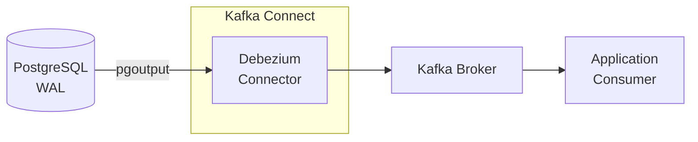

## 목적

최근 회사에서 실시간 데이터 파이프라인에 대한 요구를 대응하기 위해서 ETL을 10분 단위로 실행하는 준?실시간 데이터 파이프라인을 만들었습니다. 이러한 과정에서 진짜 실시간 데이터 파이프라인은 어떻게 구현하면 좋을지 궁금해졌습니다. 그래서 PostgreSQL CDC(Change Data Capture)를 학습하기 위한 로드맵을 만들어봤습니다. 단순히 Debezium과 Kafka를 연결해 보는 데서 끝내지 않고 아래 질문들에 답할 수 있는 것을 목표로 합니다. 

(GPT의 도움을 받아 아래 학습 로드맵을 설정했습니다.)

- CDC는 WAL을 **어떻게** 읽는가?
- 데이터 정합성은 **어떻게** 유지되는가?
- 장애가 발생하면 **어떤 일이** 생기는가?

그래서 학습 순서를 다음과 같이 잡았습니다.

> PostgreSQL 내부 동작 원리 → CDC 직접 구현 실습 → Debezium 연동 → 장애 및 운영 관점 분석
> {: .prompt-info }

## 학습 로드맵


| 주제                      | 학습 키워드                                          |
| ----------------------- | ----------------------------------------------- |
| 1. PostgreSQL 내부 원리 이해  | WAL, Logical Decoding, LSN                      |
| 2. 순수 PostgreSQL CDC 실습 | Replication Slot, Publication, Replica Identity |
| 3. End-to-End CDC 파이프라인 | Debezium, Kafka Connect, Snapshot               |
| 4. 운영 및 아키텍처 심화         | 장애 복구, 데이터 정합성, Outbox Pattern                  |


## 1주차 - CDC와 PostgreSQL WAL 이해하기

**목표:** CDC가 왜 필요한지, PostgreSQL이 트랜잭션의 변경 사항을 어떻게 기록하는지 설명할 수 있다.

학습 순서:

1. CDC란 무엇인가? Polling, Trigger, Log-based CDC 비교
2. PostgreSQL WAL(Write-Ahead Log)의 역할
3. 트랜잭션 Commit과 WAL 기록의 관계
4. Physical Replication vs Logical Replication
5. Logical Decoding과 Output Plugin의 동작 원리
6. LSN(Log Sequence Number)의 의미

> WAL은 처음부터 CDC를 위해 만들어진 기능이 아니라, **데이터 복구와 내구성 보장을 위한 로그**입니다.
> Logical Decoding이 이 로그를 읽어 논리적인 데이터 변경 이벤트로 변환합니다.
> {: .prompt-tip }

연재 예정 글:

- [1편: CDC란 무엇이고, 왜 DB를 Polling하지 않을까?](https://neoguri95.github.io/posts/cdc-what-is-it-and-why-not-polling/)
- [2편: WAL은 왜 존재하나](https://neoguri95.github.io/posts/why-need-postgresql-wal/)
- [3편: Commit시 WAL에서 일어나는 일(실습 포함)](https://neoguri95.github.io/posts/relation-of-commit-and-wal/)

## 2주차 - PostgreSQL만으로 CDC 구현하기

**목표:** Debezium이나 Kafka 없이 PostgreSQL에서 변경 이벤트를 직접 읽어 본다.

### 핵심 개념


| 개념                  | 이해해야 할 내용                   |
| ------------------- | --------------------------- |
| `wal_level=logical` | 논리적 변경 정보를 WAL에 기록하도록 설정    |
| Logical Decoding    | WAL을 읽어 논리적인 변경 이벤트로 변환     |
| Replication Slot    | 소비자가 필요로 하는 WAL 위치 추적 및 보존  |
| Publication         | 어떤 테이블과 변경 작업을 게시할지 정의      |
| Replica Identity    | UPDATE/DELETE 대상 행을 식별하는 방법 |
| LSN                 | WAL 내 위치를 표시하는 식별자          |


여기서 헷갈리기 쉬운 부분이 있습니다.
PostgreSQL의 네이티브 Logical Replication은 **Publication/Subscription** 구조입니다.
반면 Debezium은 **Publication과 Replication Slot**으로 변경 사항을 읽으며, PostgreSQL Subscription을 만들 필요가 없습니다.

### 첫 번째 실습: `test_decoding`으로 변경 사항 읽기

Docker로 PostgreSQL 17을 띄웁니다.

```bash
docker run -d \
  --name pg-cdc-lab \
  -e POSTGRES_PASSWORD=postgres \
  -p 55432:5432 \
  postgres:17 \
  -c wal_level=logical \
  -c max_replication_slots=10 \
  -c max_wal_senders=10
```

PostgreSQL에 접속합니다.

```bash
docker exec -it pg-cdc-lab psql -U postgres
```

테이블을 만들고 Logical Replication Slot을 생성합니다.

```sql
CREATE TABLE orders (
    id     BIGINT PRIMARY KEY,
    status VARCHAR(20)
);

SELECT *
FROM pg_create_logical_replication_slot('orders_slot', 'test_decoding');
```

데이터를 변경합니다.

```sql
INSERT INTO orders VALUES (1, 'PENDING');

UPDATE orders SET status = 'COMPLETED' WHERE id = 1;

DELETE FROM orders WHERE id = 1;
```

변경 사항을 직접 조회합니다.

```sql
SELECT *
FROM pg_logical_slot_peek_changes('orders_slot', NULL, NULL);
```

- `test_decoding`은 학습용 Output Plugin으로, DML 변경 내용을 사람이 읽을 수 있는 형태로 보여 줍니다.
- `pg_logical_slot_peek_changes`는 Slot의 소비 위치를 **전진시키지 않습니다.**
- `pg_logical_slot_get_changes`는 읽은 만큼 소비 위치를 **전진시킵니다.**

### 실습하며 확인할 질문

- 트랜잭션을 `ROLLBACK`하면 CDC 이벤트는 어떻게 될까?
- 두 개의 INSERT를 하나의 트랜잭션에서 실행하면?
- 변경 사항을 읽지 않으면 WAL은 계속 쌓일까?
- PK가 없는 테이블도 UPDATE/DELETE를 복제할 수 있을까?

연재 예정 글:

- 3편: Debezium 없이 PostgreSQL CDC 직접 구현해보기

## 3주차 - Debezium + Kafka로 CDC 파이프라인 구축하기

**목표:** 실무에 가까운 CDC 파이프라인을 구축한다.

Debezium은 PostgreSQL의 변경 로그를 읽어 Kafka 이벤트로 발행하고, 애플리케이션 Consumer가 이를 처리합니다.



학습할 내용:

- `pgoutput` Output Plugin
- Debezium PostgreSQL Connector 설정
- Kafka Connect와 Kafka Broker의 역할
- Initial Snapshot과 Streaming 단계
- CDC 이벤트의 `before`, `after`, `op`, `source.lsn`
- Connector 중단 및 재시작 후 이벤트 처리

Debezium은 먼저 **초기 스냅샷**으로 기존 데이터를 읽어 이벤트를 만들고, 이후 **WAL 기반 스트리밍**으로 변경 사항을 이어서 수집합니다.

참고 실습 프로젝트: [Debezium 공식 예제 (tutorial)](https://github.com/debezium/debezium-examples/tree/main/tutorial)

연재 예정 글:

- 4편: PostgreSQL + Debezium + Kafka로 실시간 CDC 파이프라인 구축하기

## 4주차 - 실무 관점에서 CDC 설계하기

**목표:** 장애 상황과 정합성 문제를 직접 재현하고, 설계 관점에서 대응 방안을 정리한다.


| 실험 주제                | 검증할 문제                                |
| -------------------- | ------------------------------------- |
| Connector 중단         | Replication Slot에 의한 WAL 보존과 디스크 사용량  |
| Connector 재시작        | 중복 이벤트 및 Offset 복구                    |
| PK 없는 테이블            | Replica Identity에 따른 UPDATE/DELETE 처리 |
| 컬럼 추가 및 타입 변경        | Schema Evolution과 Consumer 호환성        |
| CDC 이벤트 재처리          | 멱등성 및 데이터 정합성                         |
| Transactional Outbox | 비즈니스 이벤트 발행과 DB 트랜잭션의 일관성             |


> Replication Slot은 운영에서 중요한 장애 지점입니다.
> 소비자가 오래 멈추면 Slot이 필요한 WAL을 계속 보존하기 때문에 디스크 사용량이 늘어날 수 있습니다.
> {: .prompt-warning }

Slot 상태는 아래 쿼리로 관찰합니다.

```sql
SELECT
    slot_name,
    active,
    restart_lsn,
    confirmed_flush_lsn,
    pg_size_pretty(
        pg_wal_lsn_diff(pg_current_wal_lsn(), restart_lsn)
    ) AS retained_wal_distance
FROM pg_replication_slots;
```

`retained_wal_distance`는 현재 WAL 위치와 Slot이 필요로 하는 최소 위치 사이의 거리입니다.
실제 디스크 사용량과 정확히 같은 값은 아닙니다.

연재 예정 글:

- 5편: Debezium이 중단되면 PostgreSQL WAL은 어떻게 될까?
- 6편: CDC의 중복 이벤트와 데이터 정합성: 멱등성부터 Outbox Pattern까지

## 학습 완료 기준

- [ ] PostgreSQL WAL과 Logical Decoding의 관계를 설명할 수 있다
- [ ] Debezium 없이 INSERT/UPDATE/DELETE 이벤트를 직접 읽을 수 있다
- [ ] Publication과 Replication Slot의 역할을 구분할 수 있다
- [ ] Debezium과 Kafka Connect로 CDC 파이프라인을 구축할 수 있다
- [ ] Connector 중단 시 WAL 보존 상태를 분석할 수 있다
- [ ] CDC 이벤트 중복 처리와 데이터 정합성 문제의 해결책을 설명할 수 있다

## 참고 자료

- [PostgreSQL 17 — Logical Decoding](https://www.postgresql.org/docs/17/logicaldecoding.html): WAL과 Logical Decoding의 원리
- [PostgreSQL 17 — Logical Decoding Examples](https://www.postgresql.org/docs/17/logicaldecoding-example.html): 첫 실습의 기준 문서
- [PostgreSQL 17 — Logical Replication](https://www.postgresql.org/docs/17/logical-replication.html): Publication과 Subscription 구조
- [Debezium — PostgreSQL Connector](https://debezium.io/documentation/reference/stable/connectors/postgresql.html): Connector 설정, Snapshot, 이벤트 구조

## 마치며

사실 PostgreSQL을 사용하며 DB에 대한 깊은 이해없이 단순히 기능 개발에만 집중해왔습니다. 이번 학습 과정을 통해 대충 뭔지만 알고 있던 WAL, MVCC, CDC 등에 대해서 보다 깊은 이해를 가질 수 있도록 노력하겠습니다. 

블로그 역시 6편을 각각 독립적인 기술 글로 만들되, 앞편에서 생긴 의문을 다음 편의 실험으로 해결하는 방식으로 연재해보겠습니다.