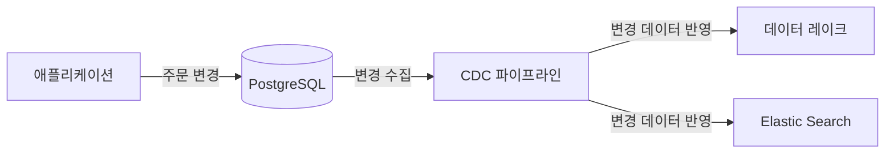
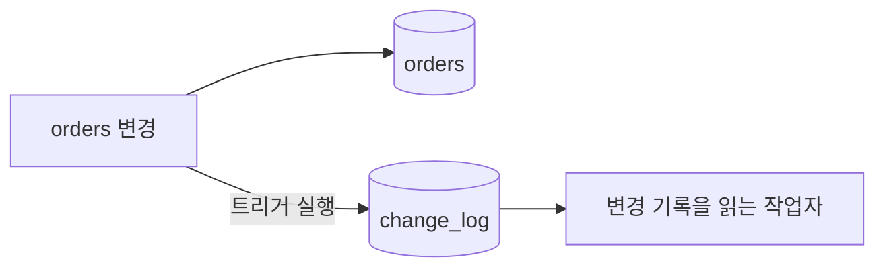
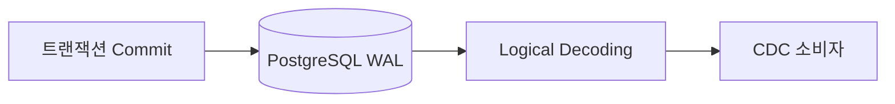

## CDC란?

CDC(Change Data Capture)는 특정한 기술이라기 보다 데이터베이스에서 발생한 변경을 감지하는 방법입니다. 그리고 CDC를 통해서 감지한 데이터 변경분을 타 시스템에게 전달함으로써 데이터 분석, 이상 감지를 가능케 할 수 있습니다.



변경 데이터를 감지할 수 있는 방법은 크게 3가지로 Query-Based CDC(Polling) / Log-Based CDC / Trigger-Based CDC 방법이 있습니다. 본인이 변경 데이터를 어떤 수준으로 감지해야 하는지, 어디에 적재해야 하는지, 변경 데이터의 양은 얼만큼인지에 따라서 적절히 방법을 선택하면 됩니다.

## Query-Based CDC(Polling)

Query-Based CDC 방식은 Polling CDC 방식이라고도 부르며 주기적으로 원천 소스 DB에 조회 쿼리를 날려서 변경 데이터를 수집하는 방식입니다. 현재 회사 ETL에서 사용하고 있는 방식이며 대상 테이블의 성격에 맞게 조회 쿼리를 날린 뒤 해당 쿼리의 결과를 목적지로 보내는 방식입니다.

### Incrementing Column

**순차적으로 증가하는 컬럼**(AUTOINCREMENT)을 기준으로 마지막 조회 시점의 `cursor_id`보다 큰 데이터들을 조회할 수 있습니다. 이러한 방식은 기존 레코드들에 대해서  update가 발생하지 않는 경우에 적합합니다. 한번 조회되어 `cursor_id`보다 작은 레코드들은 앞으로 계속 조회되지 않기 때문입니다. 즉 insert만 발생하는 테이블을 대상으로는 적합한 방식입니다. 즉, **이력성** **정보를 남기는 테이블**에 적합할 수 있겠습니다.

```sql
SELECT id, status, updated_at
FROM orders
WHERE id > :cursor_id
ORDER BY id
LIMIT 1000;
```

### Timestamp Column

`updated_at` 컬럼을 기준으로 **특정 시간 이후의 변경 데이터를 조회**하여 변경 데이터를 조회할 수 있습니다. 가장 직관적인 방식이지만 수정일시 컬럼이 존재하지 않는다거나 서비스 로직에서 수정일시 컬럼을 올바르게 갱신해주지 않는다면 사용하기 어려운 방식입니다.

```sql
SELECT id, status, updated_at
FROM orders
WHERE updated_at > :cursor_time
ORDER BY updated_at, id
LIMIT 1000;
```

수정일시 컬럼이 언제나 올바르게 갱신된다는 것을 보장하더라도 데이터 누락이 발생할 수 있습니다. 예를 들어 수정일시가 완전히 동일한 2개의 레코드가 존재한다고 가정합시다. 첫번째 레코드를 처리한 뒤 배치 작업이 실패했을 때 `cursor_time`은 첫번째 레코드의 수정일시가 될 것 입니다. 그리고 다음 배치 작업에서는 `cursor_time`보다 큰 데이터를 조회 할 것입니다. 이때 이전 배치 작업에서 (예상치 못한 배치 작업 실패로 인해서)처리되지 못한 레코드가 누락됩니다. 윈도우의 크기를 크게 늘리더라도 수정일시 값이 동일한 레코드의 갯수가 윈도우의 크기보다 작음을 보장할 수 없기 때문에 이러한 결함은 피할 수 없습니다.

### Timestamp and Incrementing Column

변경 사항이 누락되지 않게 하기 위해서 **위 2가지 방법을 결합**할 수 있습니다. **(id, updated_at) 튜플**을 마지막 처리 지점(cursor)으로 저장하면 됩니다. 이 방식은 Query-Based CDC 방식 중에서 **가장 정확한 방식**이라고 할 수 있습니다. 순차적으로 증가하는 pk 컬럼이더라도 수정일시 기준에 걸리게 되고, 배치 작업이 중간에 실패하더라도 완전 동일한 수정일시를 가진 데이터가 누락되는 일이 없습니다.

```sql
SELECT id, status, updated_at
FROM orders
WHERE id > :cursor_id
AND updated_at >= :cursor_time
ORDER BY id, updated_at
LIMIT 1000;
```

이러한 Query-Based CDC 방식은 기존 ETL에 붙이기 쉽고 별도의 DB 로그 접근 권한도 필요하지 않습니다. 최종 상태만 동기화하면 되는 작업에는 충분히 실용적입니다.

하지만 이 쿼리는 **변경 이벤트가 아니라 조회 시점의 행**을 반환합니다. 따라서 다음 문제가 생깁니다.

1. **중간 변경을 잃는다.** 두 번 이상 수정된 행도 다음 조회에는 한 번만 나타납니다. 모든 상태 전이 과정 데이터가 필요하다면 적절치 않은 방법입니다.
2. **삭제를 알기 어렵다.** 물리적으로 삭제된 행은 조회할 수 없습니다. `deleted_at` 같은 소프트 삭제 컬럼이나 별도 삭제 기록이 필요합니다.
3. **커서 설계가 까다롭다.** 같은 `updated_at`을 가진 행이 여러 개면 시각 하나만 저장한 커서로 일부 행을 건너뛸 수 있습니다. `(updated_at, id)` 같은 복합 커서, 페이지 처리, 재조회 구간과 중복 제거가 필요합니다.
4. **주기와 조회 비용을 맞바꾼다.** 간격을 줄이면 지연은 낮아지지만, 변경이 없어도 쿼리는 늘 실행되기 때문에 대상 테이블과 조회 범위가 커질수록 인덱스와 DB 부하를 살펴야 합니다.

`updated_at`을 빠짐없이 갱신하도록 애플리케이션이 작동한다는 것이 보장되어야 한다는 점도 문제가 될 수 있는 부분입니다.

> Polling이 잘못된 방식이라는 뜻은 아닙니다. 긴 주기로 현 상태의 데이터만 가져오면 되는 상황이라면 단순한 Polling이 더 알맞을 수 있습니다. 하지만 변경의 **이력과 순서**가 필요하다거나 **초 단위 실시간 동기화**가 필요해지는 순간 다른 CDC 방법을 고려해봐야 합니다.  
> {: .prompt-info }

## Trigger

트리거를 사용하면 행이 변경될 때 변경 내용을 별도의 테이블에 기록할 수 있습니다. 원본 행이 삭제되더라도 삭제 이벤트를 남길 수 있고, `OLD`와 `NEW`를 이용해 변경 전후 값을 저장할 수도 있습니다. PostgreSQL 트리거는 행 단위 또는 문장 단위로 실행할 수 있습니다.



대신 원본 테이블의 쓰기 경로에 기록 작업이 추가됩니다. 트리거와 기록 테이블의 스키마를 관리해야 하고, 기록을 읽은 뒤 정리하는 작업도 필요합니다. 트리거 함수에서 오류가 나면 원래 쓰기 작업에도 영향을 줄 수 있으므로 운영 범위를 고려해야 합니다.

트리거는 변경 이벤트를 명시적으로 설계하고 싶을 때 유용합니다. 다만 이미 많은 테이블이 있고 애플리케이션 쓰기 경로에 손대기 어렵다면 적용 비용이 커질 수 있습니다.

## Log-based CDC

PostgreSQL은 변경 내용을 WAL(Write-Ahead Log)에 기록합니다. WAL은 원래 장애 복구와 데이터 내구성을 위해 존재합니다. **Logical Decoding**은 WAL의 내용을 `INSERT`, `UPDATE`, `DELETE` 같은 논리적 변경으로 변환해 외부 소비자가 읽을 수 있게 합니다. PostgreSQL [Logical Decoding 문서](https://www.postgresql.org/docs/current/logicaldecoding.html)는 이를 SQL로 발생한 변경을 외부 소비자에게 스트리밍하는 기능으로 설명합니다.



이 방식은 테이블을 반복 조회하지 않고 커밋된 변경을 로그 위치에 따라 읽습니다. 따라서 최종 상태만 조회하는 Polling과 달리 변경 스트림을 다룰 수 있습니다. PostgreSQL의 [Logical Replication 구조](https://www.postgresql.org/docs/current/logical-replication-architecture.html)에서는 WAL을 읽은 뒤 Output Plugin이 변경을 논리적 복제 프로토콜로 변환합니다. Debezium의 PostgreSQL 커넥터도 이 기능을 이용해 변경 이벤트를 전달합니다.

물론 로그를 읽는다고 운영 문제가 사라지는 것은 아닙니다. 초기 데이터는 별도 스냅샷이 필요할 수 있으며 소비자가 멈춘 동안 필요한 WAL을 보존하는 Replication Slot을 관리해야 합니다. 슬롯이 오래 전진하지 않으면 WAL이 쌓여 디스크 사용량이 증가할 수 있습니다. 소비자가 재시작할 때 중복 이벤트가 생길 가능성도 고려해야 합니다. PostgreSQL [Logical Decoding Concepts 문서](https://www.postgresql.org/docs/current/logicaldecoding-explanation.html)는 슬롯이 소비자의 상태를 알지 못한 채 필요한 WAL을 보존한다고 경고합니다.

## 세 방식은 언제 선택할까?


| 방식            | 변경을 읽는 곳                | 잘 맞는 상황                         | 주의할 점                     |
| ------------- | ----------------------- | ------------------------------- | ------------------------- |
| Polling       | 테이블의 현재 행               | 낮은 구현 비용, 분 단위 지연 허용, 최종 상태 동기화 | 중간 변경과 삭제 포착, 커서와 조회 부하   |
| Trigger       | 변경 시 실행되는 DB 함수와 기록 테이블 | 변경 전후 값을 직접 정의해 기록해야 할 때        | 쓰기 경로 영향, 트리거와 기록 테이블 관리  |
| Log-based CDC | WAL을 논리적으로 변환한 변경 스트림   | 여러 테이블의 변경 이력과 낮은 지연이 필요할 때     | 초기 스냅샷, 슬롯과 WAL 보존, 중복 처리 |


결국 선택 기준은 **초 단위의 실시간 데이터 필요한지, 최종 상태만 필요한지, 모든 변경이 필요한지, 삭제를 알아야 하는지, DB에 어떤 운영 부담을 감당할 수 있는지**를 먼저 정해야 합니다.

## 마치며

다음 글에서는 PostgreSQL이 복구를 위해 남기는 WAL이 어떻게 Logical Decoding을 거쳐 변경 이벤트가 되는지 살펴보겠습니다.

## 참고 자료

- [How to Choose the Right CDC Method for Getting Data from RDBMS into Kafka](https://developer.confluent.io/courses/data-pipelines/cdc-data-from-rdbms-into-kafka)
- [Five Advantages of Log-Based Change Data Capture](https://debezium.io/blog/2018/07/19/advantages-of-log-based-change-data-capture)
- [JDBC Source Connector for Confluent Platform](https://docs.confluent.io/kafka-connectors/jdbc/current/source-connector/overview.html)
- [PostgreSQL — Write-Ahead Logging](https://www.postgresql.org/docs/current/wal-intro.html)
- [PostgreSQL — Logical Decoding](https://www.postgresql.org/docs/current/logicaldecoding.html)
- [PostgreSQL — Logical Decoding Concepts](https://www.postgresql.org/docs/current/logicaldecoding-explanation.html)
- [PostgreSQL — CREATE TRIGGER](https://www.postgresql.org/docs/current/sql-createtrigger.html)
- [Debezium — PostgreSQL Connector](https://debezium.io/documentation/reference/stable/connectors/postgresql.html)

