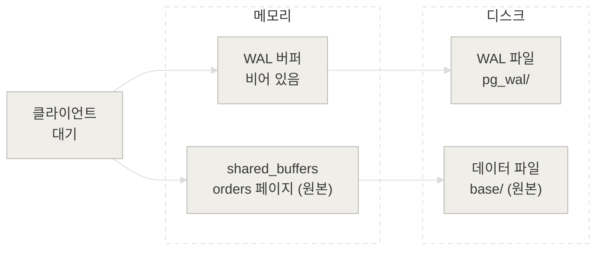
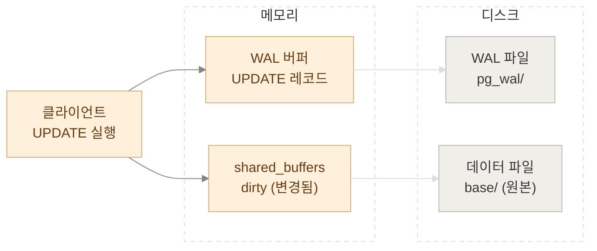
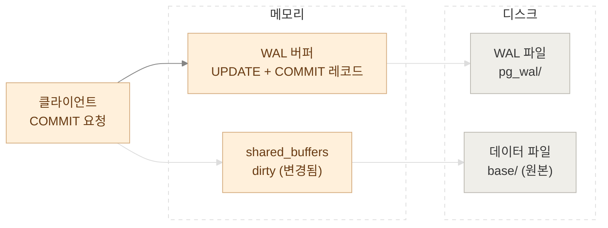
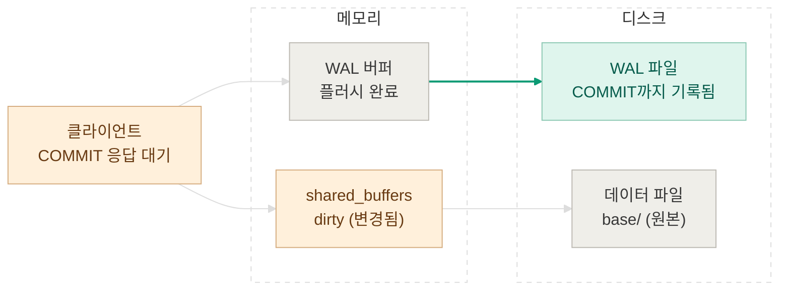
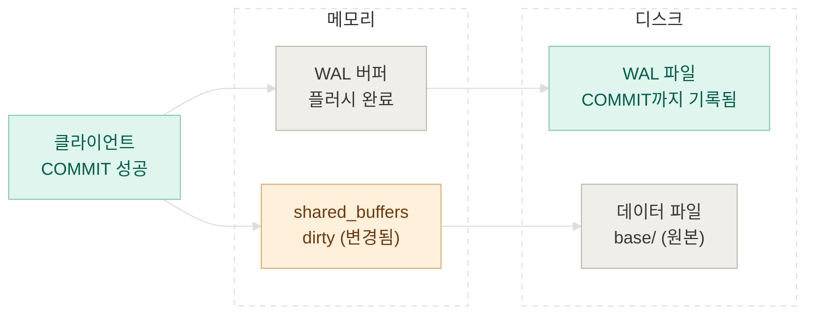
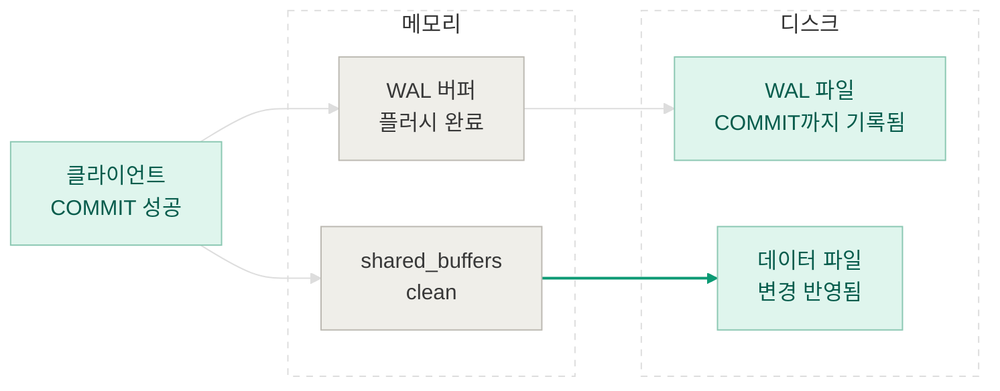

## synchronous_commit

PostgreSQL의 `synchronous_commit`은 커밋 성공 응답 전에 WAL의 처리를 어디까지 기다릴지 결정하는 설정입니다. 아래 흐름도에서는 단일 PostgreSQL에서 기본값인 `on`을 사용하는 경우입니다. 이 설정에서는 커밋 레코드까지 **WAL이 디스크에 플러시된 뒤** 성공을 응답합니다. `off`에서는 이 플러시를 기다리지 않습니다. 따라서 성공 응답 직후 크래시가 나면 최근 트랜잭션이(커밋 완료라고 응답을 받았음에도) 유실될 수 있습니다. [PostgreSQL 18 문서](https://www.postgresql.org/docs/18/runtime-config-wal.html)

아래 흐름도는 `orders` 테이블 레코드에 대해서 `UPDATE`하고 `COMMIT`하는 과정을 순서대로 보여 줍니다. 단계별 상태를 단순화한 그림이며, 실제로는 WAL 쓰기나 데이터 페이지 쓰기가 다른 시점에 먼저 일어날 수도 있습니다.

### 0. 시작

주문 행이 있는 데이터 페이지는 디스크에 저장돼 있고 자주 읽는 페이지라 `shared_buffers`에도 올라와 있다고 가정해봅시다.



*주황 = 메모리에 기록됨(아직 휘발성) · 초록 = 디스크에 안전하게 기록됨 · 회색 = 변경되지 않은 상태*

### 1. UPDATE 실행

행을 바꾸는 동안 메모리의 데이터 페이지는 `dirty`가 되고, 변경을 설명하는 WAL 레코드가 생성됩니다. 이 그림에서는 아직 어느 쪽도 디스크에 쓰이지 않습니다.



*주황 = 메모리에 기록됨(아직 휘발성) · 초록 = 디스크에 안전하게 기록됨 · 회색 = 변경되지 않은 상태*

### 2. COMMIT 요청

클라이언트가 `COMMIT`을 요청하면 트랜잭션의 커밋 레코드가 WAL에 추가됩니다. 아직 커밋 레코드가 디스크에 플러시되지 않았으므로 성공 응답을 보내지 않습니다.



*주황 = 메모리에 기록됨(아직 휘발성) · 초록 = 디스크에 안전하게 기록됨 · 회색 = 변경되지 않은 상태*

### 3. WAL 플러시

커밋 레코드를 포함한 WAL을 디스크의 `pg_wal/`에 쓰고 영구 저장을 확인합니다. 이제 크래시가 나더라도 WAL로 변경을 복구할 수 있습니다. 데이터 페이지는 여전히 메모리에서 `dirty` 상태입니다.



*주황 = 메모리에 기록됨(아직 휘발성) · 초록 = 디스크에 안전하게 기록됨 · 회색 = 변경되지 않은 상태*

### 4. 클라이언트에 COMMIT 성공 응답

WAL 플러시가 끝났으므로 클라이언트에게 성공을 알립니다. 데이터 페이지가 아직 디스크에 없더라도 서버 재시작 시 WAL 재생으로 커밋된 변경을 복원할 수 있습니다.



*주황 = 메모리에 기록됨(아직 휘발성) · 초록 = 디스크에 안전하게 기록됨 · 회색 = 변경되지 않은 상태*

### 5. 체크포인트

체크포인트 과정에서 dirty 페이지가 데이터 파일에 기록되면 해당 페이지는 마침내 clean 상태가 됩니다. 완료된 체크포인트의 REDO 지점 이전 WAL은 크래시 복구 시작에 필요하지 않지만(데이터 파일까지 반영되었으므로), 복제 슬롯(replication slot)이나 WAL 아카이브 등의 이유로 보존될 수도 있습니다. [PostgreSQL 18 문서](https://www.postgresql.org/docs/18/wal-configuration.html)



*주황 = 메모리에 기록됨(아직 휘발성) · 초록 = 디스크에 안전하게 기록됨 · 회색 = 변경되지 않은 상태*

## 실습

먼저 실습용 postgreSQL을 도커 컨테이너로 띄워주도록 하겠습니다.

```yml
services:
  postgres:
    image: postgres:18
    container_name: pg-cdc-lab
    environment:
      POSTGRES_USER: postgres
      POSTGRES_PASSWORD: postgres
      POSTGRES_DB: cdc_lab
    ports:
      - "127.0.0.1:55432:5432"
    command:
      - postgres
      - -c
      - wal_level=logical
      - -c
      - max_replication_slots=10
      - -c
      - max_wal_senders=10
    volumes:
      - pg18_data:/var/lib/postgresql
    healthcheck:
      test: ["CMD-SHELL", "pg_isready -U postgres -d cdc_lab"]
      interval: 5s
      timeout: 3s
      retries: 10

volumes:
  pg18_data:
```

psql 창에서 직접 sql을 날려보겠습니다.

```bash
docker exec -it pg-cdc-lab psql -U postgres -d postgres
```

orders 테이블을 만들고 레코드 1개를 삽입한 뒤 wal의 현재 lsn 위치를 확인해보겠습니다.

```bash
postgres=# SHOW synchronous_commit;
 synchronous_commit
--------------------
 on
(1 row)

postgres=# SHOW fsync;
 fsync
-------
 on
(1 row)

postgres=# CREATE TABLE orders (id integer PRIMARY KEY, status text);
CREATE TABLE
postgres=# INSERT INTO orders VALUES (1, 'pending');
INSERT 0 1
postgres=# CHECKPOINT;
CHECKPOINT
postgres=# SELECT pg_current_wal_insert_lsn() AS before_lsn;
 before_lsn
------------
 0/1C2F1D8
(1 row)
```

이번엔 삽입한 레코드를 수정하는 트랜잭션을 실행하고 해당 트랜잭션에서 wal의 insert_lsn, flush_lsn을 살펴보겠습니다.

```bash
postgres=# BEGIN;
UPDATE orders SET status = 'paid' WHERE id = 1;

SELECT pg_current_xact_id() AS xid,
       pg_current_wal_insert_lsn() AS insert_lsn,
       pg_current_wal_flush_lsn() AS flush_lsn;

COMMIT;

BEGIN
UPDATE 1
 xid | insert_lsn | flush_lsn
-----+------------+-----------
 767 | 0/1C2F2A0  | 0/1C2F1D8
(1 row)

COMMIT
postgres=# SELECT pg_current_wal_flush_lsn() AS after_flush_lsn;
 after_flush_lsn
-----------------
 0/1C2F308
(1 row)

postgres=# SELECT * FROM orders;
 id | status
----+--------
  1 | paid
(1 row)
```

트랜잭션 중간 확인 결과 insert_lsn(`0/1C2F2A0`)은 전진되고 flsuh_lsn(`0/1C2F1D8`)은 아직 전진되지 않은 모습입니다. commit 완료 응답 후 다시 flush_lsn(`0/1C2F308`)을 확인하면 올바르게 전진해 있는 것을 확인해볼 수 있습니다.

실제 WAL 파일에는 어떻게 기록됐을까요? s, e 옵션으로 시작과 끝 lsn을 넘겨주고 트랜잭션 ID를 넘겨주면 wal이 필터링되어 출력됩니다.

```bash
docker exec -u postgres pg-cdc-lab sh -c \
  'pg_waldump -p "$PGDATA/pg_wal" -s "0/1C2F1D8" -e "0/1C2F308" -x 767'
```
(출력이 너무 길어 약간 수정했습니다.)
```text
rmgr: Heap
  tx: 767  lsn: 0/01C2F250  desc: HOT_UPDATE

rmgr: Transaction
  tx: 767  lsn: 0/01C2F2A0  desc: COMMIT
```

같은 트랜잭션 ID(`767`)에 대해 `HOT_UPDATE` 레코드 뒤에 `COMMIT` 레코드가 기록된 것을 확인할 수 있습니다.

이번엔 실제 데이터 파일에 데이터 변경이 적용되었는지 확인해보겠습니다. 아래 쿼리는 위 수정 트랜잭션 직후에 실행했습니다. 체크포인트는 주기적으로 실행되기 때문에 일정 시간 뒤 아래 쿼리를 실행하면 전후 값이 같을 수 있기 때문입니다.

```bash
postgres=# SELECT num_done, buffers_written FROM pg_stat_checkpointer;
 num_done | buffers_written
----------+-----------------
        6 |            1027
(1 row)

postgres=# CHECKPOINT;
CHECKPOINT
postgres=# SELECT pg_stat_clear_snapshot();
 pg_stat_clear_snapshot
------------------------

(1 row)

postgres=# SELECT num_done, buffers_written FROM pg_stat_checkpointer;
 num_done | buffers_written
----------+-----------------
        7 |            1028
(1 row)
```

수정 직후 pg_stat_checkpointer를 확인해보면 num_done: 6, buffers_written: 1027이고 체크포인트를 강제로 실행한 뒤 다시 조회하면 num_done: 7, buffers_written: 1028로 올라간 것을 확인할 수 있습니다. 체크포인트로 인해서 orders 테이블의 (shared_buffers에만 존재하던)수정분이 데이터 파일에 적용된 것이죠.

## 마치며

다음 글에서는 Physical Replication과 Logical Replication의 차이에 대해서 알아보겠습니다.