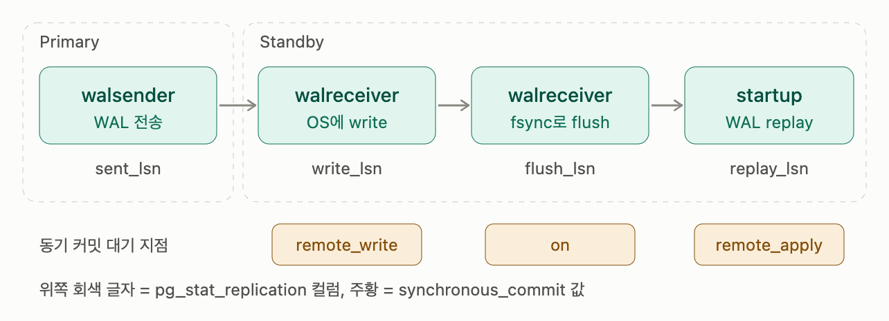
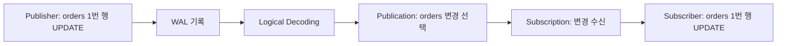

## 출발점: WAL

Physical Replication과 Logical Replication은 모두 WAL(Write-Ahead Log)을 이용하지만, **무엇을 복제할지**와 **받는 쪽에서 어떻게 적용할지**가 다릅니다. PostgreSQL은 데이터 파일을 변경하기 전에 복구에 필요한 정보를 WAL에 기록합니다. Physical Replication은 WAL을 받아 데이터 파일의 변경을 재생하고, Logical Replication은 WAL을 해석해 테이블의 행 변경으로 전달합니다.

## Physical Replication

Standby가 Primary의 WAL을 받아 **클러스터 전체의 변경을 물리적으로 재생**합니다. 다만 두 서버의 모든 파일이 비트 단위로 같다는 뜻은 아닙니다. 예를 들어 WAL에 기록되지 않는 hint bit는 Standby에서 별도로 기록될 수 있습니다.

- 복제 단위: 클러스터 전체 (모든 DB, 테이블, 인덱스, DDL 포함). 일부 테이블만 고를 수 없습니다.
- Standby 상태: `hot_standby = on`이면 복구 중 읽기 전용 쿼리를 받을 수 있습니다. 승격 전에는 일반적인 데이터 변경을 할 수 없습니다.

> **Standby 운영 방식**
> - Cold standby: 평소에는 실행하지 않는 예비 서버나 백업을 가리키는 표현입니다. 장애 시 시작하고 복구해야 합니다.
> - Warm standby: WAL을 재생하지만 승격 전에는 읽기 쿼리를 받지 않습니다.
> - Hot standby: WAL을 재생하면서 읽기 전용 쿼리를 받습니다.

- 제약: 일반적으로 같은 PostgreSQL 메이저 버전과 호환되는 하드웨어 아키텍처가 필요합니다. 테이블스페이스를 사용한다면 경로도 맞춰야 합니다.
- 장점: 클러스터 전체와 DDL이 함께 반영되고, 장애 시 Standby를 승격할 수 있습니다.
- 주 용도: 고가용성, 읽기 부하 분산, 재해 복구.
- 동기/비동기: 스트리밍 복제는 기본적으로 비동기입니다. 동기 복제를 설정하면 지정한 Standby의 확인을 기다린 뒤 커밋을 응답하므로, 확인받은 트랜잭션의 내구성을 높이는 대신 쓰기 지연이 늘어납니다. 실제 장애 복구에서 어떤 Standby를 승격하느냐도 중요합니다.

버전·아키텍처 제약과 복제 방식은 [PostgreSQL Standby 문서](https://www.postgresql.org/docs/17/warm-standby.html), hint bit와 읽기 제약은 [Hot Standby 문서](https://www.postgresql.org/docs/17/hot-standby.html)에서 확인할 수 있습니다.

### synchronous_standby_names

Primary 쪽에 설정하는 값으로 커밋할 때 어떤 Standby의 확인을 기다릴지 정합니다. 기본값은 비어 있어 비동기이며, 값을 지정해도 실제로 연결되어 스트리밍 중인 Standby가 있어야 동기 복제가 동작합니다. 각 트랜잭션의 `synchronous_commit` 설정에 따라서도 대기 여부가 달라집니다.

Standby의 이름은 Standby가 접속할 때 쓰는 `application_name`입니다. Standby의 `primary_conninfo`에 지정합니다.

```ini
# Standby 1의 postgresql.conf (또는 postgresql.auto.conf)
primary_conninfo = 'host=primary user=repl application_name=s1'
```

Primary에서는 `pg_stat_replication`의 `application_name` 컬럼으로 확인할 수 있습니다.

```ini
# 1) 우선순위 방식: 목록 앞쪽부터 n대를 동기로 사용
synchronous_standby_names = 'FIRST 1 (s1, s2, s3)'

# 2) 쿼럼 방식: 목록 중 아무거나 n대만 응답하면 커밋
synchronous_standby_names = 'ANY 2 (s1, s2, s3)'

# 3) 옛 문법: FIRST 1과 같은 의미
synchronous_standby_names = 's1, s2'
```

### synchronous_commit

Physical 스트리밍 복제에서는 Primary의 walsender가 WAL을 보내고, Standby의 walreceiver가 받아 쓰며, startup 프로세스가 재생(redo)합니다. 수신·디스크 반영·재생 위치는 서로 다를 수 있습니다. 동기 복제를 사용하는 트랜잭션에서 `synchronous_commit`은 어느 단계의 확인까지 기다릴지 정합니다.



- `on`(기본): 동기 Standby가 커밋 WAL을 내구성 있는 저장소에 flush할 때까지 기다립니다. 다만 replay가 끝나기 전이라면 **Standby에서 바로 조회할 때 아직 보이지 않을 수 있습니다.**
- `remote_apply`: 동기 Standby가 WAL을 재생해 해당 변경을 쿼리에서 볼 수 있을 때까지 기다립니다. 해당 Standby에서의 read-your-writes가 필요할 때 유용하지만 대기 시간이 더 길 수 있습니다.
- `remote_write`: 동기 Standby가 WAL을 운영체제에 썼다는 확인까지만 기다립니다. Standby의 OS 장애에는 아직 flush되지 않은 WAL을 잃을 수 있으므로, `on`보다 내구성 보장이 약합니다.

이 설정은 Physical Replication 전용이 아닙니다. PostgreSQL의 Logical Replication Subscriber도 동기 Standby가 될 수 있습니다. 여기서는 Physical Standby의 수신·재생 단계를 설명하기 위해 사용했습니다.

> 필요한 수의 동기 Standby가 응답하지 않으면 커밋이 대기합니다. `ANY 1 (s1, s2)`처럼 후보를 여러 대 두면 한 대의 장애를 견딜 수 있지만, 사용 가능한 후보가 모두 사라지는 경우의 운영 절차도 필요합니다.

각 모드의 내구성과 조회 가능 시점은 [PostgreSQL WAL 설정 문서](https://www.postgresql.org/docs/17/runtime-config-wal.html#RUNTIME-CONFIG-WAL-SETTINGS)에 정리되어 있습니다.

### Hot Standby 충돌

먼저 MVCC를 살펴보고 Hot Standby 충돌이 왜 발생하는지 살펴보겠습니다.

#### 1. 행마다 버전이 존재

PostgreSQL에서 UPDATE는 기존 행을 고치지 않고 새 버전의 행을 하나 더 만듭니다. 그리고 각 행 버전(튜플)에는 2가지 정보가 들어있습니다.

- xmin: 이 버전을 만든 트랜잭션 ID
- xmax: 이 버전을 지운(혹은 대체한) 트랜잭션 ID
    - xmax가 0이면 이 버전을 삭제·대체한 트랜잭션 ID나 행 잠금 정보가 기록되지 않았다는 뜻입니다. 이것만으로 현재 쿼리에서 보이는 최신 버전인지는 판단할 수 없습니다.
    - xmax가 0이 아닌 경우
        - 다른 세션이 `SELECT ... FOR UPDATE`로 그 행을 잠갔을 경우. 락 정보가 xmax에 기록됩니다.
        - 어떤 트랜잭션에서 그 행을 UPDATE/DELETE 하다가 ROLLBACK 된 경우. 해당 트랜잭션 ID가 xmax에 기록됩니다. 이 경우 해당 행 버전은 xmax가 0이 아니지만 유효한 행입니다.
        - 다른 세션에서 아직 커밋되지 않은 UPDATE/DELETE가 해당 행을 건드리고 있는 경우에도 xmax가 0이 아닙니다.

> **특정 레코드의 xmin, xmax를 확인하는 쿼리**
> ```sql
> SELECT xmin, xmax, * FROM orders WHERE id = 1;
> ```

예를 들어 트랜잭션 100이 행을 넣고, 트랜잭션 200이 그 행을 수정해 커밋하면 한동안 아래 두 버전이 남습니다.

```
버전 A: xmin=100, xmax=200, status=pending   ← 옛 버전
버전 B: xmin=200, xmax=0,   status=paid      ← 새 버전
```

#### 2. 스냅샷

쿼리는 가시성을 판단할 때 스냅샷을 사용합니다. 스냅샷은 어느 트랜잭션의 변경을 볼 수 있는지 판단하는 데 필요한 정보입니다. `READ COMMITTED`에서는 문장마다 새 스냅샷을 사용하고, `REPEATABLE READ`에서는 트랜잭션 동안 같은 스냅샷을 사용합니다.

- xmin: 진행 중인 트랜잭션 중 가장 오래된 ID. 이보다 작은 ID는 전부 끝났다는 것(커밋 or 롤백)이 보장됩니다.
- xmax: 스냅샷 시점 다음에 부여될 ID. 이 이상의 ID는 모두 스냅샷 이후에 시작했으므로 항상 보이지 않습니다.
- xip 목록: xmin과 xmax 사이에서 아직 진행 중이던 ID 목록

```sql
SELECT pg_current_snapshot();
-- 결과 예: 100:103:100
-- xmin:xmax:xip
```

**가시성 판단 규칙**

튜플의 xmin(만든 트랜잭션)을 스냅샷과 비교하는 방식은 이렇습니다.

1. xid < 스냅샷 xmin: 확실히 끝난 트랜잭션. 커밋인지 롤백인지만 확인하면 됨
2. xid ≥ 스냅샷 xmax: 스냅샷 이후 시작 → 안 보임
3. 그 사이에 있고 xip 목록에 있음: 진행 중 → 안 보임
4. 그 사이에 있고 xip 목록에 없음: 끝났음. 커밋인지 롤백인지 확인

여기서 커밋인지 롤백인지 확인하는 것은 별도의 트랜잭션 상태 기록(`pg_xact`, 예전 이름 `clog`)을 봐서 판단합니다. 매번 이걸 조회하면 느리기 때문에 한번 확인한 결과는 튜플 헤더에 `hint bit`로 표시해 둡니다.

> `READ COMMITTED`(기본)는 SQL 문장마다 새 스냅샷을 사용합니다. `REPEATABLE READ`와 `SERIALIZABLE`은 트랜잭션의 첫 비제어 문장에서 얻은 스냅샷을 유지합니다. `SERIALIZABLE`에는 이와 별도로 직렬화 충돌을 탐지하는 규칙도 있습니다.

즉 스냅샷 정보와 튜플의 `xmin`·`xmax`, 해당 트랜잭션의 커밋 상태를 함께 확인해 행 버전의 가시성을 판단합니다.

#### 3. VACUUM

언젠가 옛 버전의 행은 아무도 볼 필요가 없어집니다. 이런 행을 **dead tuple**이라 부르고, 그 공간을 회수하는 게 VACUUM입니다.

VACUUM은 아직 필요한 오래된 행 버전을 제거하지 않도록, 실행 중인 트랜잭션뿐 아니라 복제 슬롯 등 행 정리를 지연시키는 요인도 고려합니다. 위 예시의 버전 A는 이전 상태를 볼 수 있는 스냅샷이 더는 없을 때 제거할 수 있습니다. 단순히 트랜잭션 ID가 200보다 큰지만 비교해 제거 여부를 결정하는 것은 아닙니다.

Primary에 오래 열린 트랜잭션이 있다면 관련 행 버전을 정리하지 못해 테이블이 부풀어 오를 수 있습니다(bloat). 그렇다고 VACUUM이 모든 테이블에서 아무 일도 못 하는 것은 아닙니다.

#### 4. 충돌이 생기는 이유

Primary에서 동작하는 VACUUM은 기본적으로 Standby에서 실행 중인 쿼리의 스냅샷을 알지 못합니다. 그래서 Primary가 제거한 옛 행 버전을 Standby 쿼리가 아직 필요로 할 수 있습니다.

```
10:00:00  Standby: 분석 쿼리 시작 (스냅샷 xmin = 150), 버전 A를 읽는 중
10:00:05  Primary: 트랜잭션 200이 UPDATE 후 커밋
10:00:10  Primary: VACUUM 실행. Primary에는 버전 A가 필요한 스냅샷이 없어 이를 제거하고, 정리 작업을 WAL에 기록
10:00:10  Standby: 이 WAL이 도착
```

이제 Standby의 startup 프로세스는 곤란해집니다. 이 WAL을 재생하면 분석 쿼리가 보고 있던 버전 A가 사라지는데, 그 쿼리의 스냅샷(xmin 150)은 아직 버전 A가 필요합니다. 그대로 재생하면 쿼리가 틀린 결과를 내게 됩니다. 선택지는 둘뿐입니다.

1. replay를 멈추고 쿼리가 끝나길 기다린다 → 복제 지연 증가
2. 쿼리를 취소하고 replay를 진행한다 → 사용자 쿼리 실패

스트리밍으로 받은 WAL은 `max_standby_streaming_delay`(기본 30초)가 허용하는 적용 지연을 넘으면 충돌 쿼리를 취소합니다. **이는 각 쿼리의 실행 시간을 30초까지 보장한다는 뜻이 아닙니다.** 앞선 충돌이 지연 시간을 이미 사용했다면 뒤의 쿼리는 더 빨리 취소될 수 있습니다. 아카이브에서 읽은 WAL에는 `max_standby_archive_delay`가 적용됩니다. 이때 나오는 에러는 아래와 같습니다.

```
ERROR: canceling statement due to conflict with recovery
DETAIL: User query might have needed to see row versions that must be removed.
```

#### 5. 해결 방법

Hot Standby 충돌은 읽기 쿼리 완료와 WAL 적용 지연 사이에서 운영 목적에 맞는 선택이 필요합니다.

1. `hot_standby_feedback = on`

   Standby의 오래된 스냅샷 정보를 Primary에 알려 VACUUM이 필요한 행 버전을 제거하지 않게 합니다. 행 정리로 인한 충돌은 줄지만, 오래 실행되는 쿼리가 있으면 Primary의 테이블 팽창을 유발할 수 있습니다. 연결이 끊긴 동안에는 피드백만으로 보호할 수 없고, DDL 잠금 등 다른 종류의 충돌도 막지 못합니다.

2. `max_standby_streaming_delay` 늘리기

   WAL 적용을 더 오래 미뤄 충돌 쿼리가 끝날 시간을 줍니다. 쿼리 취소는 줄 수 있지만 그동안 Standby 데이터는 뒤처집니다. 고가용성이 주목적인 Standby라면 지연을 짧게 두는 편이 적합할 수 있습니다.

Hot Standby의 충돌 원인에는 VACUUM의 행 정리뿐 아니라 Primary에서 실행한 `DROP TABLE` 같은 DDL의 잠금도 있습니다. `hot_standby_feedback`만으로 모든 쿼리 취소를 없앨 수는 없습니다. 자세한 충돌 종류와 대응 방법은 [PostgreSQL Hot Standby 문서](https://www.postgresql.org/docs/17/hot-standby.html)에 정리되어 있습니다.

## Logical Replication

이번에는 주문 서비스의 PostgreSQL에서 `orders` 테이블만 분석용 PostgreSQL로 보내고 싶다고 가정해 봅시다. 원본에는 `orders`와 `users`가 있지만, 분석용 서버에는 주문 데이터만 필요합니다. Physical Replication으로는 클러스터 전체를 복제해야 합니다. Logical Replication은 **어떤 테이블의 변경을 보낼지 선택**할 수 있습니다.

PostgreSQL에 내장된 Logical Replication에서는 변경을 보내는 쪽을 **Publisher**, 받는 쪽을 **Subscriber**라고 부릅니다. Publisher의 **Publication**에는 보낼 테이블을 등록하고, Subscriber의 **Subscription**은 그 Publication을 구독합니다.

```text
Publisher                              Subscriber
orders: 복제 대상  ── Publication ──→ orders: 변경 적용
users:  복제 대상 아님                 users:  복제되지 않음
```

Publication은 필요하면 특정 행이나 컬럼만 보내도록 더 좁힐 수도 있습니다. [PostgreSQL Publication 문서](https://www.postgresql.org/docs/17/logical-replication-publication.html)

### 1. 주문 상태를 바꾸면 무엇이 전달될까?

Publisher의 `orders` 테이블에 다음 행이 있다고 해봅시다.

```text
id=1, status='PENDING'
```

주문이 결제되어 `status`를 `PAID`로 바꾸면 PostgreSQL은 먼저 WAL에 변경을 기록합니다. Logical Decoding은 WAL을 읽어 **`orders`의 id=1 행이 변경되었다**는 논리적 정보를 만들어 냅니다. Subscriber는 이 변경을 받아 자신의 `orders` 테이블에 적용합니다.



결과적으로 Subscriber에서도 `id=1, status='PAID'`가 됩니다. Physical Replication처럼 데이터 파일의 특정 바이트를 그대로 재생하는 방식이 아니라, 받은 쪽의 PostgreSQL이 **자기 테이블에 행 변경을 적용**하는 방식입니다. 이 때문에 서로 다른 PostgreSQL 메이저 버전 간 마이그레이션에도 활용할 수 있습니다. [PostgreSQL Logical Replication 문서](https://www.postgresql.org/docs/17/logical-replication.html)

### 2. 구독을 시작하기 전 주문은 어떻게 될까?

구독을 만들기 전부터 `orders`에 주문 1,000건이 있었다면, 그 데이터는 어떻게 될까요? PostgreSQL의 Subscription은 기본적으로 **기존 데이터를 먼저 복사**합니다. 그동안 새 주문이 들어와도 복사 시작 시점 이후의 변경을 이어서 적용합니다. 따라서 최초 복사가 끝나기를 기다리는 동안 발생한 주문을 건너뛰지 않습니다. [PostgreSQL Subscription 문서](https://www.postgresql.org/docs/17/logical-replication-subscription.html)

```text
기존 주문 1,000건 복사 → 복사 중 발생한 변경 따라잡기 → 이후 변경 계속 적용
```

### 3. Subscriber가 잠시 멈추면?

Subscriber가 한 시간 동안 멈췄는데 Publisher에서는 주문 500건이 더 생겼다고 해봅시다. Subscriber가 다시 켜졌을 때 어디부터 읽어야 할까요? **Replication Slot**이 Subscriber가 확인한 위치를 추적하고, 필요한 WAL을 Publisher에 남겨 둡니다.

```text
10:00  Subscriber 중단, 마지막으로 확인한 WAL 위치를 Slot이 기억
10:30  Publisher에서 주문 INSERT/UPDATE 계속 발생
11:00  Subscriber 재시작, 남아 있는 WAL부터 변경을 받아 따라잡음
```

이 방식에는 대가가 있습니다. Subscriber가 오래 멈추면 필요한 WAL이 Publisher의 디스크에 계속 쌓입니다. 복제 슬롯을 운영할 때는 **Subscriber가 마지막으로 확인한 위치와 Publisher의 WAL 사용량**을 함께 봐야 합니다. WAL 보존 상한을 설정할 수도 있지만, 필요한 WAL이 제거되면 그 위치부터 계속 복제할 수 없습니다. [PostgreSQL Replication Slot 문서](https://www.postgresql.org/docs/17/warm-standby.html#STREAMING-REPLICATION-SLOTS)

### 4. 테이블 구조를 바꾸면?

Publisher의 `orders`에 `delivery_address` 컬럼을 추가했다고 해봅시다. Logical Replication은 행 데이터의 변경을 전달하지만 `ALTER TABLE` 같은 **DDL은 Subscriber에 자동 적용하지 않습니다.** Subscriber의 테이블 구조도 맞춰 줘야 합니다. 새 데이터가 기존 Subscriber 스키마에 맞지 않으면 복제가 멈출 수 있습니다.

`id`가 `serial` 또는 identity 컬럼이라면 행에 들어 있는 `id=1` 같은 **값은 복제**됩니다. 그러나 다음 번호를 만드는 **시퀀스의 현재 값은 복제되지 않습니다.** Subscriber를 쓰기 서버로 전환하려 한다면 이 값도 확인해야 합니다. [PostgreSQL Logical Replication 제한 사항](https://www.postgresql.org/docs/17/logical-replication-restrictions.html)

### 5. UPDATE할 행은 어떻게 찾을까?

앞의 `status='PENDING' → 'PAID'` 변경을 Subscriber에 적용하려면 어느 주문을 고칠지 알아야 합니다. `id`가 Primary Key라면 **`id=1`인 행**을 찾으면 됩니다. PostgreSQL은 이때 사용할 행 식별 정보를 **Replica Identity**라고 부릅니다. 기본값은 테이블의 Primary Key입니다.

Primary Key도 적절한 고유 인덱스도 없다면 `UPDATE`와 `DELETE`를 게시할 때 문제가 됩니다. `REPLICA IDENTITY FULL`로 옛 행 전체를 식별 정보로 보낼 수 있지만, 기록량과 행 검색 비용이 늘 수 있습니다. 가능한 경우 안정적인 키를 두는 편이 단순합니다. [PostgreSQL Publication 문서](https://www.postgresql.org/docs/17/logical-replication-publication.html)

Subscriber는 일반 PostgreSQL 서버라서 쓰기 자체는 가능합니다. 하지만 복제되는 `orders`에 직접 주문을 추가하면 Publisher에서 온 변경과 충돌할 수 있습니다. 예를 들어 Subscriber에 이미 `id=1` 행이 있는데 Publisher에서 같은 `id=1`의 INSERT가 오면 키 충돌로 복제가 멈춥니다. [PostgreSQL 복제 충돌 문서](https://www.postgresql.org/docs/17/logical-replication-conflicts.html)

### CDC에서는 어떻게 사용할까?

위 예시는 **PostgreSQL에서 PostgreSQL로** 행 변경을 복제했습니다. CDC에서는 같은 Logical Decoding 결과를 다른 시스템이 읽을 수도 있습니다. Debezium은 Publication과 Replication Slot으로 변경을 읽어 이벤트로 전달합니다. 이 경우 PostgreSQL의 Subscription은 만들지 않습니다.

```text
PostgreSQL 내장 복제: Publisher → Subscription → 다른 PostgreSQL의 orders 테이블
Debezium CDC:       Publisher → Debezium    → 변경 이벤트 → Kafka 등
```

둘 다 WAL의 논리적 변경을 이용하지만 받는 쪽과 결과물이 다릅니다. [Debezium PostgreSQL 커넥터 문서](https://debezium.io/documentation/reference/stable/connectors/postgresql.html)

## 무엇을 선택할까?

| 비교 항목 | Physical Replication | Logical Replication |
| --- | --- | --- |
| 복제 범위 | 클러스터 전체 | 선택한 데이터베이스의 테이블과 행 변경 |
| 받는 쪽 | 복구 중인 Standby. 승격 전 일반 쓰기 불가 | 별도 PostgreSQL 서버 또는 Logical Decoding 소비자 |
| DDL과 시퀀스 | WAL 재생으로 클러스터 변경에 포함 | DDL과 시퀀스 상태는 별도 관리 |
| PostgreSQL 메이저 버전 | 서로 다른 메이저 버전 간 복제에 적합하지 않음 | 서로 다른 메이저 버전 간 복제에 활용 가능 |
| 대표 용도 | 장애 대비, 읽기 전용 복제본 | 일부 데이터 배포, 마이그레이션, CDC 이벤트 수집 |
| 주요 운영 문제 | 복제 지연, Hot Standby 쿼리 충돌, 장애 전환 | 슬롯으로 인한 WAL 보존, 스키마 불일치, 적용 충돌 |

앞의 주문 서비스로 돌아가 보겠습니다. **Primary가 장애 나면 Standby를 승격해 서비스를 이어가야 한다**면 클러스터 전체를 복제하는 Physical Replication이 알맞습니다. 반대로 **분석용 서버에는 `orders`만 보내고 `users`는 제외하고 싶다**면 Logical Replication을 고려할 수 있습니다. 주문 변경을 Kafka 이벤트로 전달하고 싶다면 Logical Decoding을 사용하는 CDC 도구가 필요합니다.

두 방식 모두 비동기일 수 있고 동기 복제도 설정할 수 있습니다. **Physical은 빠르고 Logical은 느리다**처럼 이름만으로 지연 시간을 단정하기보다, 무엇을 어디로 보내고 장애 시 어떤 상태를 보장해야 하는지를 먼저 정해야 합니다.
