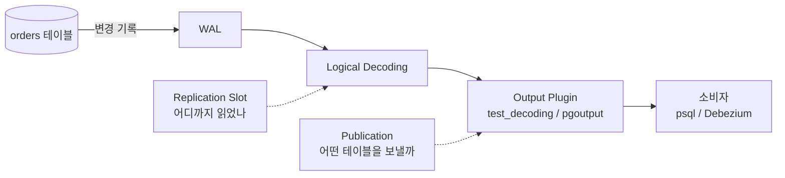
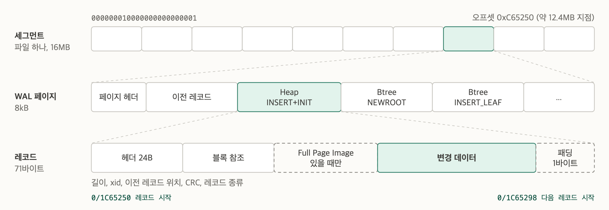
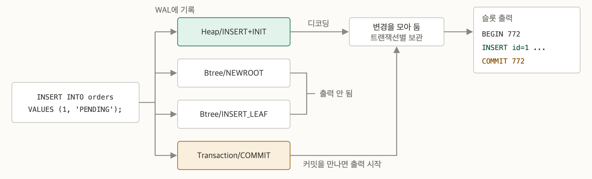
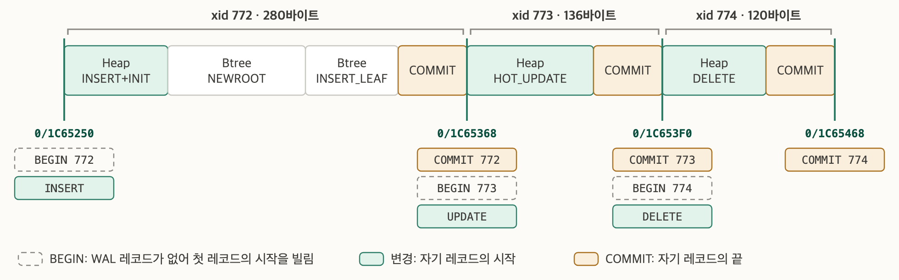
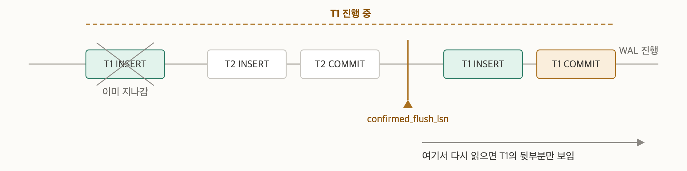
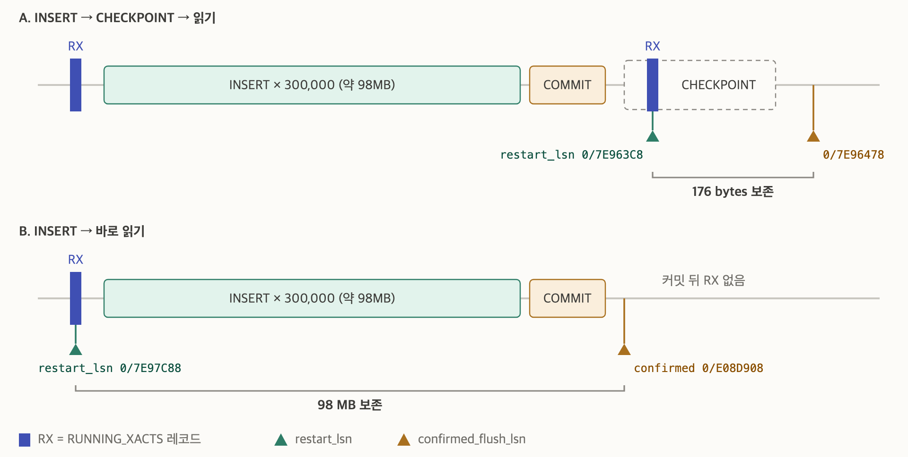
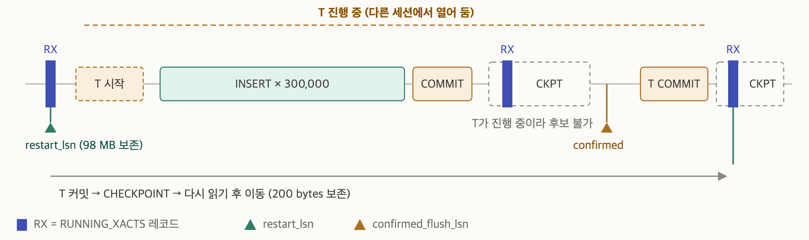

## 들어가며

이번 글에서는 Debezium과 Kafka 없이, PostgreSQL에 들어 있는 기능만으로 변경 이벤트를 직접 읽어 보겠습니다. 로드맵에서 정해 둔 아래 질문에 실습으로 답하는 것이 목표입니다.

- 트랜잭션을 `ROLLBACK`하면 CDC 이벤트는 어떻게 될까?
- 두 개의 INSERT를 하나의 트랜잭션에서 실행하면?
- 변경 사항을 읽지 않으면 WAL은 계속 쌓일까?
- PK가 없는 테이블도 UPDATE/DELETE를 복제할 수 있을까?

## 핵심 개념

실습 전에 등장하는 개념들이 어떻게 연결되는지 먼저 정리해 보겠습니다.



| 개념 | 역할 |
| --- | --- |
| `wal_level=logical` | Logical Decoding에 필요한 정보(옛 행의 키 등)를 WAL에 추가로 기록 |
| Logical Decoding | WAL을 읽어 트랜잭션 단위의 행 변경으로 변환 |
| Output Plugin | 변환 결과를 어떤 형식으로 내보낼지 결정 |
| Replication Slot | 소비자가 어디까지 읽었는지 기억하고 아직 필요한 WAL을 보존 |
| Publication | 어떤 테이블의 어떤 변경(INSERT/UPDATE/DELETE)을 내보낼지 정의 |
| Replica Identity | UPDATE/DELETE 때 대상 행을 식별하기 위해 WAL에 남길 옛 값 |
| LSN | WAL 안의 위치. 슬롯의 진행 상황도 LSN으로 표시 |

Output Plugin은 두 가지를 사용합니다.

- **`test_decoding`**: 사람이 읽을 수 있는 텍스트로 출력하는 학습용 플러그인입니다. Publication을 보지 않고 모든 테이블의 변경을 출력합니다.
- **`pgoutput`**: PostgreSQL 내장 Logical Replication과 Debezium이 사용하는 플러그인입니다. 바이너리 프로토콜로 출력하며, **Publication에 포함된 테이블만** 내보냅니다.

### 세그먼트, 페이지, 레코드

슬롯의 출력을 읽으려면 WAL이 어떤 구조인지 알아 두는 편이 좋습니다. WAL은 논리적으로 하나로 이어지는 로그이지만, 실제로는 기본 16MB 크기의 파일로 나뉘어 `pg_wal` 디렉터리에 저장됩니다. 이 파일 하나가 **세그먼트**입니다. 세그먼트는 8kB 크기의 페이지로 나뉘고, 페이지 안에 **레코드**가 이어집니다. 레코드는 "데이터 페이지를 이렇게 바꿨다"를 적은 변경 기록 한 건으로, WAL을 이루는 최소 단위입니다. [WAL Internals 문서](https://www.postgresql.org/docs/18/wal-internals.html)



LSN은 WAL 안의 바이트 위치이므로 LSN만 알면 파일과 위치를 계산할 수 있습니다. 예를 들어 `0/1C65250`을 16MB(`0x1000000`)로 나누면 몫이 `0x1`, 나머지가 `0xC65250`입니다. 즉, 1번 세그먼트의 약 12.4MB 지점입니다. 뒤에서 사용할 `pg_walfile_name()`이 이 계산을 대신해 줍니다.

레코드는 8바이트 단위로 정렬됩니다. 그래서 그림의 71바이트 레코드 뒤에는 1바이트 패딩이 붙고, 다음 레코드는 72바이트 뒤에서 시작합니다.

## 실습 환경

[3편](https://neoguri95.github.io/posts/relation-of-commit-and-wal/)과 같은 Docker Compose 설정을 사용합니다. 핵심은 `wal_level=logical`입니다.

```yml
services:
  postgres:
    image: postgres:18
    container_name: pg-cdc-lab
    environment:
      POSTGRES_USER: postgres
      POSTGRES_PASSWORD: postgres
      POSTGRES_DB: cdc_lab
    ports:
      - "127.0.0.1:55432:5432"
    command:
      - postgres
      - -c
      - wal_level=logical
      - -c
      - max_replication_slots=10
      - -c
      - max_wal_senders=10
    volumes:
      - pg18_data:/var/lib/postgresql

volumes:
  pg18_data:
```

```bash
docker compose up -d
docker exec -it pg-cdc-lab psql -U postgres -d cdc_lab
```

## 실습 1: 변경 이벤트 읽기

### 슬롯 만들기

테이블을 만들고 `test_decoding` 플러그인을 쓰는 Logical Replication Slot을 만듭니다.

```sql
CREATE TABLE orders (id BIGINT PRIMARY KEY, status VARCHAR(20));

SELECT * FROM pg_create_logical_replication_slot('orders_slot', 'test_decoding');
```

```text
  slot_name  |    lsn
-------------+-----------
 orders_slot | 0/1C606E8
```

슬롯 상태를 확인해 보겠습니다.

```sql
SELECT slot_name, plugin, slot_type, active, restart_lsn, confirmed_flush_lsn
FROM pg_replication_slots;
```

```text
  slot_name  |    plugin     | slot_type | active | restart_lsn | confirmed_flush_lsn
-------------+---------------+-----------+--------+-------------+---------------------
 orders_slot | test_decoding | logical   | f      | 0/1C606B0   | 0/1C606E8
```

LSN 두 개에 대해서 알아봅시다.

- **`confirmed_flush_lsn`**: 소비자가 "여기까지 받았다"고 확인한 위치입니다. 다음에 읽을 때 이 이후의 트랜잭션부터 받습니다.
- **`restart_lsn`**: 디코딩을 다시 시작하려면 필요한 가장 오래된 WAL 위치입니다. PostgreSQL은 **이 위치 이후의 WAL을 지우지 않습니다.**

`active`가 `f`인 것은 지금 이 슬롯에 연결된 소비자가 없다는 뜻입니다.

### INSERT, UPDATE, DELETE

```sql
INSERT INTO orders VALUES (1, 'PENDING');
UPDATE orders SET status = 'COMPLETED' WHERE id = 1;
DELETE FROM orders WHERE id = 1;

SELECT * FROM pg_logical_slot_peek_changes('orders_slot', NULL, NULL);
```

```text
    lsn    | xid |                                      data
-----------+-----+---------------------------------------------------------------------------------
 0/1C65250 | 772 | BEGIN 772
 0/1C65250 | 772 | table public.orders: INSERT: id[bigint]:1 status[character varying]:'PENDING'
 0/1C65368 | 772 | COMMIT 772
 0/1C65368 | 773 | BEGIN 773
 0/1C65368 | 773 | table public.orders: UPDATE: id[bigint]:1 status[character varying]:'COMPLETED'
 0/1C653F0 | 773 | COMMIT 773
 0/1C653F0 | 774 | BEGIN 774
 0/1C653F0 | 774 | table public.orders: DELETE: id[bigint]:1
 0/1C65468 | 774 | COMMIT 774
```

세 문장이 각각 자동 커밋되어 트랜잭션 3개(772, 773, 774)가 `BEGIN ... COMMIT`으로 묶여 나옵니다. DELETE에는 삭제된 행 전체가 아니라 **Primary Key인 `id`만** 나오는 점도 눈여겨볼만 합니다.

### 왜 같은 LSN이 반복될까?

출력을 보면 `0/1C65250`이 두 줄, `0/1C65368`이 세 줄입니다. 이유를 확인하기 위해 같은 구간의 WAL 레코드를 [pg_waldump](https://www.postgresql.org/docs/18/pgwaldump.html)로 직접 살펴보겠습니다. LSN은 환경마다 다르므로 자신의 출력에 나온 값으로 바꿔서 실행합니다.

```bash
docker exec pg-cdc-lab pg_waldump -p /var/lib/postgresql/18/docker/pg_wal -s 0/1C65250 -e 0/1C65468
```

```text
 tx  |  lsn       | len | 레코드
-----+------------+-----+-------------------------
 772 | 0/01C65250 |  71 | Heap/INSERT+INIT     <-- INSERT 시작
 772 | 0/01C65298 |  90 | Btree/NEWROOT
 772 | 0/01C652F8 |  64 | Btree/INSERT_LEAF
 772 | 0/01C65338 |  46 | Transaction/COMMIT   <-- INSERT 종료
 773 | 0/01C65368 |  84 | Heap/HOT_UPDATE      <-- UPDATE 시작
 773 | 0/01C653C0 |  46 | Transaction/COMMIT   <-- UPDATE 종료
 774 | 0/01C653F0 |  68 | Heap/DELETE          <-- DELETE 시작
 774 | 0/01C65438 |  46 | Transaction/COMMIT   <-- DELETE 종료
```

필요한 항목만 추려서 표로 정리했습니다. SQL 한 문장과 레코드는 1:1이 아닙니다. 레코드는 페이지 수준의 물리적 변경 단위로 남기 때문입니다.

- **INSERT**: 레코드 4개가 남습니다. 빈 PK 인덱스에 첫 키가 들어가면서 루트 페이지를 만드는 `Btree/NEWROOT`까지 기록되었습니다.
- **UPDATE**: 인덱스에 없는 `status`만 바뀌어 인덱스를 건드리지 않는 `HOT_UPDATE`로 기록되었습니다.

이 레코드들이 슬롯 출력이 되는 과정은 아래와 같습니다.



인덱스 레코드는 행 변경 이벤트가 아니므로 출력되지 않습니다. 행 변경은 트랜잭션별로 모아 두었다가 커밋 레코드를 만나면 내보냅니다. 슬롯 출력이 커밋 순서대로 나오는 이유이기도 합니다.

이제 레코드를 WAL에 놓인 순서대로 펼치고, 출력의 `lsn` 컬럼 값을 겹쳐 보겠습니다.



`lsn` 컬럼의 기준은 줄의 종류마다 다릅니다.

| 출력 줄 | `lsn` 값 |
| --- | --- |
| `BEGIN` | 트랜잭션 첫 레코드의 시작 위치 |
| INSERT/UPDATE/DELETE | 해당 변경 레코드의 시작 위치 |
| `COMMIT` | COMMIT 레코드의 끝 위치 |

그래서 값이 겹치는 패턴은 두 가지입니다.

- **`BEGIN`과 첫 변경**: `BEGIN`은 WAL에 별도 레코드가 없어서 첫 레코드의 위치를 빌려 씁니다. 이번에는 그 첫 레코드가 변경 레코드이므로 값이 같습니다.
- **`COMMIT`과 다음 `BEGIN`**: COMMIT 레코드의 끝이 곧 다음 레코드의 시작이라 값이 같습니다.

xid 772의 COMMIT 레코드를 보면 차이가 분명합니다. 레코드 자체는 `0/1C65338`에서 시작하지만, 슬롯 출력에는 끝 위치인 `0/1C65368`이 찍혀 있습니다. 다만 `COMMIT`과 다음 `BEGIN`의 값이 항상 같은 것은 아닙니다. 두 트랜잭션 사이에 체크포인트 관련 레코드나 다른 세션의 쓰기가 끼면 값이 달라집니다.

### peek과 get의 차이

`peek`을 다시 실행해도 같은 9줄이 나옵니다. 슬롯의 위치가 그대로이기 때문입니다.

```sql
SELECT confirmed_flush_lsn FROM pg_replication_slots WHERE slot_name = 'orders_slot';
-- 0/1C606E8  (변화 없음)
```

이번에는 `get`으로 읽어 보겠습니다. 출력은 `peek`과 같지만, 읽은 뒤 슬롯 위치가 움직입니다.

```sql
SELECT * FROM pg_logical_slot_get_changes('orders_slot', NULL, NULL);
-- (같은 9줄 출력)

SELECT confirmed_flush_lsn FROM pg_replication_slots WHERE slot_name = 'orders_slot';
-- 0/1C655A8  (읽기를 마친 WAL 위치로 전진)

SELECT count(*) FROM pg_logical_slot_peek_changes('orders_slot', NULL, NULL);
-- 0
```

`confirmed_flush_lsn`이 `0/1C655A8`로 이동했고, 더 이상 읽을 변경이 없습니다. 마지막 COMMIT의 끝(`0/1C65468`)보다 더 나아갔는데, 슬롯이 출력 여부와 상관없이 읽고 지나간 WAL 위치까지 전진하기 때문입니다. 이 구간에는 체크포인트 레코드처럼 행 변경이 아닌 레코드만 있었습니다.

> `get`은 결과를 돌려주는 순간 소비가 확정됩니다. 결과를 받은 애플리케이션이 처리 도중 죽으면 그 변경은 다시 받을 수 없습니다.
> 그래서 실제 CDC 도구는 SQL 함수 대신 **스트리밍 복제 프로토콜**로 변경을 받고, 처리가 끝난 위치를 따로 서버에 알려 줍니다. Debezium이 장애 후 일부 이벤트를 **중복으로** 받을 수는 있어도 **유실하지 않는** 이유가 여기에 있습니다.
{: .prompt-tip }

## 실습 2: 트랜잭션은 어떻게 전달될까?

### ROLLBACK하면?

```sql
BEGIN;
INSERT INTO orders VALUES (10, 'PENDING');
ROLLBACK;

SELECT * FROM pg_logical_slot_get_changes('orders_slot', NULL, NULL);
```

```text
 lsn | xid | data
-----+-----+------
(0 rows)
```

아무것도 나오지 않습니다. INSERT 자체는 WAL에 기록되지만, Logical Decoding은 트랜잭션을 **커밋될 때까지 모아 두었다가** 커밋된 것만 내보냅니다. 롤백된 트랜잭션은 버립니다. 소비자 입장에서는 롤백된 데이터를 걱정할 필요가 없습니다.

### 하나의 트랜잭션에 INSERT 두 개

```sql
BEGIN;
INSERT INTO orders VALUES (2, 'PENDING');
INSERT INTO orders VALUES (3, 'PENDING');
COMMIT;

SELECT * FROM pg_logical_slot_get_changes('orders_slot', NULL, NULL);
```

```text
    lsn    | xid |                                     data
-----------+-----+-------------------------------------------------------------------------------
 0/1C657C0 | 776 | BEGIN 776
 0/1C657C0 | 776 | table public.orders: INSERT: id[bigint]:2 status[character varying]:'PENDING'
 0/1C65848 | 776 | table public.orders: INSERT: id[bigint]:3 status[character varying]:'PENDING'
 0/1C65900 | 776 | COMMIT 776
```

두 INSERT가 하나의 `BEGIN ... COMMIT` 안에 묶여 나옵니다. 트랜잭션 경계가 이벤트에도 그대로 남기 때문에, 소비자는 "주문과 주문 상세가 함께 커밋되었다" 같은 원자성을 알 수 있습니다.

### 두 트랜잭션이 동시에 진행되면?

세션 A가 먼저 시작했는데 세션 B가 먼저 커밋하면 어떤 순서로 나올까요?

```text
세션 A: BEGIN; INSERT INTO orders VALUES (100, 'A-first');   -- xid 779
세션 B: BEGIN; INSERT INTO orders VALUES (200, 'B-second'); COMMIT;   -- xid 780
세션 A: COMMIT;
```

```text
    lsn    | xid |                                  data
-----------+-----+-------------------------------------------------------------------------
 0/1C67A20 | 780 | BEGIN 780
 0/1C67A20 | 780 | table public.orders: INSERT: id[bigint]:200 status[character varying]:'B-second'
 0/1C67AD8 | 780 | COMMIT 780
 0/1C67998 | 779 | BEGIN 779
 0/1C67998 | 779 | table public.orders: INSERT: id[bigint]:100 status[character varying]:'A-first'
 0/1C67B08 | 779 | COMMIT 779
```

A의 INSERT가 WAL에 먼저 기록되었지만(`0/1C67998`), 이벤트는 **먼저 커밋한 B(780)부터** 나옵니다. 그래서 `lsn` 컬럼이 위아래로 뒤섞여 보입니다.

WAL에는 여러 트랜잭션의 기록이 뒤섞여 들어갑니다. Logical Decoding은 이를 트랜잭션별로 모아 두었다가(이 버퍼를 **Reorder Buffer**라고 부릅니다) **커밋 순서대로** 한 트랜잭션씩 통째로 내보냅니다. 커밋 순서는 DB에 변경이 실제로 반영된 순서이므로, 소비자가 이 순서대로 적용하면 원본과 같은 상태가 됩니다.

### DDL은?

```sql
ALTER TABLE orders ADD COLUMN memo text;
SELECT * FROM pg_logical_slot_get_changes('orders_slot', NULL, NULL);
```

```text
    lsn    | xid |    data
-----------+-----+------------
 0/1C67B08 | 781 | BEGIN 781
 0/1C7F6C8 | 781 | COMMIT 781
```

DDL 트랜잭션은 내용 없이 빈 `BEGIN/COMMIT`만 나옵니다. **DDL은 변경 이벤트로 전달되지 않습니다.** 대신 이후의 INSERT에는 새 컬럼이 포함되어 나옵니다.

```sql
INSERT INTO orders VALUES (4, 'PENDING', 'after alter');
SELECT * FROM pg_logical_slot_get_changes('orders_slot', NULL, NULL);
```

```text
table public.orders: INSERT: id[bigint]:4 status[character varying]:'PENDING' memo[text]:'after alter'
```

Logical Decoding은 변경이 일어난 **그 시점의 테이블 정의**로 WAL을 해석하기 때문에, 컬럼이 추가된 전후의 변경을 각각 올바른 형태로 보여 줍니다. 하지만 소비자 쪽 스키마를 맞추는 일은 별도로 해야 합니다.

## 실습 3: 읽지 않으면 WAL은 계속 쌓일까?

슬롯을 만들어 두고 읽지 않는 상황을 만들어 보겠습니다. 변경 이벤트를 만들 `events` 테이블에 30만 건을 넣고 슬롯 상태를 봅니다.

```sql
CREATE TABLE events (id bigserial PRIMARY KEY, payload text);

-- 확인용 쿼리
SELECT pg_walfile_name(restart_lsn) AS slot_needs,
       (SELECT min(name) FROM pg_ls_waldir()) AS oldest_wal_file,
       pg_walfile_name(pg_current_wal_lsn()) AS current_wal_file,
       pg_size_pretty(pg_wal_lsn_diff(pg_current_wal_lsn(), restart_lsn)) AS retained
FROM pg_replication_slots;
```

`pg_walfile_name()`은 LSN이 어느 WAL 세그먼트 파일(기본 16MB)에 들어 있는지 알려 줍니다.

```text
-- INSERT 전
        slot_needs        |     oldest_wal_file      |     current_wal_file     | retained
--------------------------+--------------------------+--------------------------+----------
 000000010000000000000001 | 000000010000000000000001 | 000000010000000000000001 | 255 kB
```

```sql
INSERT INTO events (payload) SELECT repeat('x', 200) FROM generate_series(1, 300000);
CHECKPOINT;
```

```text
-- INSERT + CHECKPOINT 후
        slot_needs        |     oldest_wal_file      |     current_wal_file     | retained
--------------------------+--------------------------+--------------------------+----------
 000000010000000000000001 | 000000010000000000000001 | 000000010000000000000007 | 98 MB
```

WAL은 `07` 파일까지 진행했는데, 체크포인트를 해도 `01` 파일이 지워지지 않습니다. 슬롯이 `01`부터 필요하다고 붙잡고 있기 때문입니다. [2편](https://neoguri95.github.io/posts/why-need-postgresql-wal/)에서 본 것처럼 원래 체크포인트가 끝나면 그 이전 WAL은 복구에 필요 없으므로 지우거나 재사용할 수 있습니다. 슬롯은 이 정리를 막습니다.

이제 변경을 모두 읽어 보겠습니다.

```sql
SELECT count(*) FROM pg_logical_slot_get_changes('orders_slot', NULL, NULL);
-- 300004

SELECT restart_lsn, confirmed_flush_lsn,
       pg_size_pretty(pg_wal_lsn_diff(pg_current_wal_lsn(), restart_lsn)) AS retained
FROM pg_replication_slots;
```

```text
 restart_lsn | confirmed_flush_lsn | retained
-------------+---------------------+-----------
 0/7E963C8   | 0/7E96478           | 176 bytes
```

`restart_lsn`까지 끝으로 따라왔습니다. 체크포인트를 실행하면 슬롯이 더 이상 붙잡지 않는 WAL이 정리됩니다.

```sql
CHECKPOINT;
SELECT name FROM pg_ls_waldir() ORDER BY name;
```

```text
           name
--------------------------
 000000010000000000000007
 000000010000000000000008
 000000010000000000000009
 00000001000000000000000A
 00000001000000000000000B
 00000001000000000000000C
 00000001000000000000000D
 00000001000000000000000E
```

`01`~`06`이 사라졌습니다.

### 다 읽었는데 왜 그대로일까?

방금은 읽기 전에 `CHECKPOINT`를 실행했습니다. 이번에는 체크포인트 없이 INSERT 직후 바로 읽어 보겠습니다.

```sql
INSERT INTO events (payload) SELECT repeat('x', 200) FROM generate_series(1, 300000);

SELECT count(*) FROM pg_logical_slot_get_changes('orders_slot', NULL, NULL);
-- 300002

SELECT restart_lsn, confirmed_flush_lsn,
       pg_size_pretty(pg_wal_lsn_diff(pg_current_wal_lsn(), restart_lsn)) AS retained
FROM pg_replication_slots;
```

```text
 restart_lsn | confirmed_flush_lsn | retained
-------------+---------------------+----------
 0/7E97C88   | 0/E08D908           | 98 MB
```

30만 건을 다 읽어서 `confirmed_flush_lsn`은 끝까지 전진했는데, `restart_lsn`은 거의 그대로이고 WAL도 98MB가 남아 있습니다.

이유는 `restart_lsn`이 **디코딩을 안전하게 다시 시작할 수 있는 지점으로만** 이동할 수 있기 때문입니다.

먼저 확인한 위치(`confirmed_flush_lsn`)에서 바로 다시 읽을 수 없는 이유부터 보겠습니다.



이 위치부터 다시 읽으면 T1의 뒷부분만 보입니다. 앞부분은 이미 지나갔으니 T1을 온전한 트랜잭션으로 내보낼 수 없습니다. 게다가 디코더는 그 시점에 어떤 트랜잭션이 진행 중이었는지조차 모릅니다.

그래서 다시 시작하려면 "이 위치에서 진행 중인 트랜잭션은 이것들"이라는 정보가 필요합니다. PostgreSQL은 이 정보를 `RUNNING_XACTS` 레코드로 WAL에 기록하고, 슬롯은 이 레코드를 기준으로 재시작 지점을 정합니다.

1. 슬롯이 `RUNNING_XACTS`를 읽습니다. 레코드에는 진행 중인 트랜잭션 목록이 들어 있습니다.
2. 그 시점의 상태(스냅샷)를 `pg_logical/snapshots/`에 저장하고, 그 위치를 재시작 후보로 등록합니다.
3. `confirmed_flush_lsn`이 후보를 지나가면 `restart_lsn`을 그 위치로 옮깁니다.

앞의 두 결과를 나란히 놓으면 차이가 보입니다(그림에서 RX는 `RUNNING_XACTS`).



- **A. CHECKPOINT 후 읽기**: 체크포인트가 커밋 뒤에 `RUNNING_XACTS`를 남겼고, `restart_lsn`이 그 위치로 이동했습니다. 같은 절차를 반복해 pg_waldump로 확인해 보면, `restart_lsn`이 체크포인트가 남긴 `RUNNING_XACTS`의 LSN과 정확히 같았습니다.
- **B. 바로 읽기**: 커밋 뒤에 `RUNNING_XACTS`가 하나도 없습니다. 재시작 후보가 생기지 않았으니 `restart_lsn`은 INSERT 이전 위치에 남고, 그 뒤 98MB가 보존됩니다.

`RUNNING_XACTS`는 다음 시점에 기록됩니다.

| 시점 | 설명 |
| --- | --- |
| 체크포인트 | 체크포인트마다 기록. A가 이 경우 |
| 백그라운드 라이터 | WAL 활동이 있으면 약 15초마다 기록 |
| 슬롯 생성 | 시작 지점을 잡기 위해 기록 |

B에서는 INSERT 직후 바로 읽어서 백그라운드 기록이 끼어들 틈이 없었습니다. INSERT와 읽기 사이의 간격이 길면 CHECKPOINT 없이도 `restart_lsn`이 따라올 수 있습니다.

체크포인트로 해당 레코드를 남긴 뒤 한 번 더 읽으면 `restart_lsn`이 따라옵니다.

```sql
CHECKPOINT;
SELECT count(*) FROM pg_logical_slot_get_changes('orders_slot', NULL, NULL);
-- 0  (새 변경은 없지만 슬롯 위치가 갱신됨)
```

```text
        slot_needs        | retained
--------------------------+-----------
 00000001000000000000000E | 176 bytes
```

슬롯이 이제 `0E`부터만 필요하다고 바뀌었습니다. 이제 `07`~`0D`는 더 이상 슬롯이 붙잡고 있지 않으므로, 이후 체크포인트에서 정리 대상이 됩니다.

```sql
CHECKPOINT;
SELECT name FROM pg_ls_waldir() ORDER BY name;
```

> 제 환경에서는 슬롯이 전진한 직후의 체크포인트에서 바로 지워지지 않고, 몇 번의 체크포인트 뒤에야 정리되는 경우도 있었습니다. 실제 파일이 지워지는 시점은 내부 상태에 따라 늦어질 수 있으니, 모니터링은 파일 목록보다 `restart_lsn` 기준의 `retained` 값으로 하는 편이 정확합니다.
{: .prompt-info }

정리된 뒤의 파일 목록입니다.

```text
           name
--------------------------
 00000001000000000000000E
 00000001000000000000000F
 000000010000000000000010
 000000010000000000000011
 000000010000000000000012
 000000010000000000000013
 000000010000000000000014
 000000010000000000000015
```

`07`~`0D`가 사라졌습니다. `0F` 이후 파일은 아직 쓰이지 않은 미래의 세그먼트입니다. PostgreSQL은 다 쓴 WAL 파일을 바로 지우지 않고 이름을 바꿔 재사용하기 때문에(`min_wal_size`만큼), **파일 개수만 보면 WAL이 줄지 않은 것처럼 보일 수 있습니다.** 파일 이름을 함께 봐야 합니다.

### 긴 트랜잭션이 있으면?

`RUNNING_XACTS`가 있어도 그 순간 진행 중인 트랜잭션이 있으면 문제가 달라집니다. 그 위치에서 다시 시작하면 진행 중인 트랜잭션의 앞부분을 놓치기 때문입니다. 같은 실습 환경에서 따로 확인해 보았습니다.

```text
세션 A: BEGIN; INSERT INTO orders VALUES (9001, 'OPEN');   -- 커밋하지 않고 둠
세션 B: 30만 건 INSERT → CHECKPOINT → get_changes
세션 A: COMMIT;
세션 B: CHECKPOINT → get_changes
```



세션 B가 30만 건을 다 읽고 체크포인트까지 거쳤는데도, `restart_lsn`은 세션 A의 트랜잭션이 시작되기 직전에 머물러 98MB가 남았습니다. 체크포인트가 남긴 `RUNNING_XACTS`에는 A가 진행 중으로 기록되어 있어서 재시작 지점으로 쓸 수 없기 때문입니다. A가 커밋하고 다시 체크포인트를 거친 뒤 읽자 그제야 `restart_lsn`이 따라왔습니다(200 bytes).

실무에서 `idle in transaction` 상태로 방치된 세션이 WAL을 붙잡는 이유가 바로 이것입니다.

정리하면 다음과 같습니다.

- 슬롯을 읽지 않으면 WAL은 **계속 쌓입니다.** 기본값(`max_slot_wal_keep_size = -1`)에서는 상한도 없습니다.
- 다 읽어도 `restart_lsn`은 `confirmed_flush_lsn`보다 늦게 따라올 수 있습니다. 특히 **긴 트랜잭션**이 있으면 그 시작 지점 근처에 붙잡힙니다.
- WAL 정리는 슬롯이 전진한 **뒤의 체크포인트**에서 일어납니다.
- 슬롯이 여러 개라면 **가장 뒤처진 슬롯**을 기준으로 보존됩니다. 실습 중에 다른 슬롯을 하나 더 만들어 두었더니, 이 슬롯을 다 읽었는데도 WAL이 지워지지 않았습니다. 범인은 아무도 읽지 않던 두 번째 슬롯이었습니다.

> 실습이 끝나면 슬롯을 꼭 삭제하세요. 소비자가 없는 슬롯은 운영 DB의 디스크를 가득 채우는 대표적인 원인입니다.
> `SELECT pg_drop_replication_slot('orders_slot');`
{: .prompt-warning }

## 실습 4: PK가 없는 테이블도 UPDATE/DELETE를 복제할 수 있을까?

이번 실습에서는 출력을 짧게 보기 위해 두 옵션을 사용합니다. `include-xids=0`은 `BEGIN 772` 대신 `BEGIN`만 출력하고, `skip-empty-xacts=1`은 행 변경이 없는 트랜잭션을 생략합니다. 결과에는 행 변경 줄만 옮겼습니다. [test_decoding 문서](https://www.postgresql.org/docs/18/test-decoding.html)

```sql
SELECT data FROM pg_logical_slot_get_changes('orders_slot', NULL, NULL,
       'include-xids', '0', 'skip-empty-xacts', '1');
```

### PK가 있는 테이블

먼저 PK가 있는 `orders`에서 일반 컬럼과 PK를 각각 바꿔 봅니다.

```sql
UPDATE orders SET status = 'PAID' WHERE id = 2;
UPDATE orders SET id = 20 WHERE id = 2;
```

```text
table public.orders: UPDATE: id[bigint]:2 status[character varying]:'PAID' memo[text]:null
table public.orders: UPDATE: old-key: id[bigint]:2 new-tuple: id[bigint]:20 status[character varying]:'PAID' memo[text]:null
```

- 일반 컬럼만 바뀌면 새 행만 나옵니다. 새 행의 `id=2`로 대상 행을 찾을 수 있으니까요.
- PK가 바뀌면 `old-key: id=2`가 추가로 나옵니다. 새 행의 `id=20`만으로는 원래 어느 행이었는지 알 수 없기 때문입니다.

이렇게 **대상 행을 찾기 위해 WAL에 남기는 옛 값**을 결정하는 설정이 Replica Identity입니다. 기본값(`DEFAULT`)은 Primary Key입니다. 실습 1의 DELETE에 `id`만 나왔던 것도 이 때문입니다.

### PK가 없는 테이블

이번에는 PK가 없는 로그 테이블을 만들어 봅니다.

```sql
CREATE TABLE order_logs (order_id bigint, message text);

INSERT INTO order_logs VALUES (1, 'created');
UPDATE order_logs SET message = 'paid' WHERE order_id = 1;
DELETE FROM order_logs WHERE order_id = 1;
```

```text
table public.order_logs: INSERT: order_id[bigint]:1 message[text]:'created'
table public.order_logs: UPDATE: order_id[bigint]:1 message[text]:'paid'
table public.order_logs: DELETE: (no-tuple-data)
```

DELETE가 `(no-tuple-data)`로 나옵니다. 행이 삭제되었다는 사실만 있고 **어느 행인지 알 수 없습니다.** UPDATE도 새 값만 있어서, `order_id=1`인 행이 여러 개라면 그중 어느 행이 바뀌었는지 소비자는 알 수 없습니다.

### Publication에 넣으면 원본 쓰기가 실패한다

여기서 Publication에 이 테이블을 넣어 보겠습니다.

```sql
CREATE PUBLICATION logs_pub FOR TABLE order_logs;

INSERT INTO order_logs VALUES (2, 'created');
-- INSERT 0 1

UPDATE order_logs SET message = 'paid' WHERE order_id = 2;
```

```text
ERROR:  cannot update table "order_logs" because it does not have a replica identity and publishes updates
HINT:  To enable updating the table, set REPLICA IDENTITY using ALTER TABLE.
```

```sql
DELETE FROM order_logs WHERE order_id = 2;
```

```text
ERROR:  cannot delete from table "order_logs" because it does not have a replica identity and publishes deletes
HINT:  To enable deleting from the table, set REPLICA IDENTITY using ALTER TABLE.
```

실패한 것은 복제가 아니라 **원본 DB의 UPDATE/DELETE 자체**입니다. PostgreSQL은 소비자가 적용할 수 없는 변경이 게시되는 것을 막기 위해 쓰기 시점에 거부합니다. INSERT는 대상 행을 찾을 필요가 없으므로 성공합니다.

실무로 옮겨 보면, Debezium을 붙이면서 PK 없는 테이블을 Publication에 추가하는 순간 **그 테이블을 수정하는 애플리케이션 기능이 에러를 내기 시작할 수 있다**는 뜻입니다.

> `test_decoding`만 사용할 때는 에러가 나지 않았습니다. 이 검사는 **UPDATE/DELETE를 게시하는 Publication에 포함된 테이블**에만 적용됩니다. [PostgreSQL Publication 문서](https://www.postgresql.org/docs/18/logical-replication-publication.html)
{: .prompt-info }

### REPLICA IDENTITY FULL

PK를 추가할 수 없다면 행 전체를 옛 값으로 남기도록 바꿀 수 있습니다.

```sql
ALTER TABLE order_logs REPLICA IDENTITY FULL;

UPDATE order_logs SET message = 'paid' WHERE order_id = 2;
DELETE FROM order_logs WHERE order_id = 2;
```

```text
table public.order_logs: UPDATE: old-key: order_id[bigint]:2 message[text]:'created' new-tuple: order_id[bigint]:2 message[text]:'paid'
table public.order_logs: DELETE: order_id[bigint]:2 message[text]:'paid'
```

이제 UPDATE/DELETE가 성공하고, 옛 행 전체가 이벤트에 담깁니다. 다만 모든 UPDATE/DELETE마다 행 전체를 WAL에 추가로 쓰므로 WAL이 늘어나고, 받는 쪽도 행 전체를 비교해서 대상을 찾아야 합니다.

| 설정 | WAL에 남기는 옛 값 | 언제 쓰나 |
| --- | --- | --- |
| `DEFAULT` | Primary Key | 기본값. PK가 있으면 이것으로 충분 |
| `USING INDEX 인덱스명` | 지정한 UNIQUE + NOT NULL 인덱스의 컬럼 | PK는 없지만 고유 키가 있을 때 |
| `FULL` | 행 전체 | 키가 전혀 없을 때, 또는 소비자가 변경 전 값 전체가 필요할 때 |
| `NOTHING` | 없음 | UPDATE/DELETE를 게시하지 않는 테이블 |

Debezium 이벤트의 `before` 필드도 이 설정을 따릅니다. 기본값에서는 위 실습 결과처럼 DELETE에는 PK만, UPDATE에는 PK가 바뀐 경우에만 옛 PK가 담깁니다. 변경 전 값 전체가 필요하면 `FULL`로 바꿔야 합니다. [Debezium PostgreSQL 변경 이벤트 값 설명](https://docs.redhat.com/ja/documentation/red_hat_integration/2022.q3/html/debezium_user_guide/about-values-in-debezium-postgresql-change-events)

## 실습 5: Debezium이 쓰는 pgoutput + Publication

마지막으로 Debezium과 같은 조합인 `pgoutput` 플러그인과 Publication으로 읽어 보겠습니다. `orders`만 담은 Publication을 만들고, `orders`와 `order_logs`를 모두 바꿉니다.

```sql
CREATE PUBLICATION orders_pub FOR TABLE orders;
SELECT * FROM pg_create_logical_replication_slot('orders_pgoutput_slot', 'pgoutput');

INSERT INTO orders VALUES (30, 'PENDING');
INSERT INTO order_logs VALUES (30, 'created');
UPDATE orders SET status = 'PAID' WHERE id = 30;
```

`pgoutput`은 바이너리를 출력하므로 `peek_binary_changes`로 읽습니다. 프로토콜 버전과 구독할 Publication 이름을 옵션으로 넘깁니다. 각 메시지의 첫 바이트가 메시지 종류를 나타내므로 그것만 꺼내 보겠습니다.

```sql
SELECT lsn, xid, chr(get_byte(data, 0)) AS msg_type, length(data) AS bytes
FROM pg_logical_slot_peek_binary_changes('orders_pgoutput_slot', NULL, NULL,
       'proto_version', '1', 'publication_names', 'orders_pub');
```

```text
    lsn    | xid | msg_type | bytes
-----------+-----+----------+-------
 0/E0B1208 | 798 | B        |    21
 0/E0B1208 | 798 | R        |    64
 0/E0B1208 | 798 | I        |    28
 0/E0B12C0 | 798 | C        |    26
 0/E0B1338 | 800 | B        |    21
 0/E0B1338 | 800 | U        |    25
 0/E0B13B8 | 800 | C        |    26
```

| 메시지 | 의미 |
| --- | --- |
| `B` | Begin. 트랜잭션 시작 |
| `R` | Relation. 테이블의 스키마(이름, 컬럼, 타입) 정보 |
| `I` / `U` / `D` | Insert / Update / Delete |
| `C` | Commit |

두 가지를 확인할 수 있습니다.

1. **`order_logs`를 바꾼 트랜잭션(799)이 아예 없습니다.** 같은 시점에 `test_decoding` 슬롯에서는 세 트랜잭션이 모두 보였습니다. `pgoutput`은 Publication에 포함된 테이블의 변경만 내보냅니다.
2. **`R` 메시지가 행 데이터보다 먼저 옵니다.** 행 메시지에는 컬럼 이름 없이 값만 들어 있고, 소비자는 앞서 받은 Relation 정보로 이를 해석합니다. 테이블 구조가 바뀌면 새 `R` 메시지가 다시 전송됩니다.

Debezium은 이 바이너리 메시지를 받아 `before`, `after`, `op`, `source.lsn`을 가진 JSON 이벤트로 바꿔 Kafka에 보냅니다. 메시지 형식은 [Logical Replication 메시지 형식 문서](https://www.postgresql.org/docs/18/protocol-logicalrep-message-formats.html)에서 확인할 수 있습니다.

## 실습 정리

실습이 끝나면 슬롯과 Publication을 정리합니다.

```sql
SELECT pg_drop_replication_slot('orders_slot');
SELECT pg_drop_replication_slot('orders_pgoutput_slot');
DROP PUBLICATION orders_pub, logs_pub;
```

## 질문에 대한 답

| 질문 | 답 |
| --- | --- |
| `ROLLBACK`하면? | 이벤트가 나오지 않습니다. 커밋된 트랜잭션만 전달됩니다. |
| 한 트랜잭션에 INSERT 두 개? | 하나의 `BEGIN ... COMMIT` 안에 묶여 나옵니다. 동시에 진행된 트랜잭션은 **커밋 순서대로** 나옵니다. |
| 읽지 않으면 WAL이 쌓일까? | 쌓입니다. 슬롯의 `restart_lsn` 이후 WAL은 체크포인트가 지나도 지워지지 않습니다. 긴 트랜잭션이 있으면 다 읽은 뒤에도 잠시 붙잡혀 있을 수 있습니다. |
| PK 없는 테이블의 UPDATE/DELETE? | 그대로는 어느 행인지 식별할 수 없습니다. UPDATE/DELETE를 게시하는 Publication에 넣으면 **원본의 UPDATE/DELETE가 에러**를 냅니다. PK나 고유 인덱스를 두거나 `REPLICA IDENTITY FULL`을 설정해야 합니다. |

## 마치며

PostgreSQL만으로도 변경 이벤트를 읽는 것 자체는 어렵지 않았습니다. 하지만 실제로 써 보니 **어디까지 읽었는지 기록하고, 장애가 나도 유실 없이 이어서 읽고, 바이너리 메시지를 해석해 다른 시스템으로 보내는 일**은 직접 구현하기 번거롭다는 것을 알 수 있었습니다. Debezium이 맡아 주는 것이 바로 이 부분입니다.

다음 글에서는 Debezium과 Kafka Connect로 이번 실습의 `pgoutput` + Publication 조합을 그대로 사용하는 CDC 파이프라인을 구축해 보겠습니다.

## 참고 자료

- [PostgreSQL 18 — Logical Decoding Concepts](https://www.postgresql.org/docs/18/logicaldecoding-explanation.html)
- [PostgreSQL 18 — Logical Decoding SQL Interface](https://www.postgresql.org/docs/18/logicaldecoding-sql.html)
- [PostgreSQL 18 — test_decoding](https://www.postgresql.org/docs/18/test-decoding.html)
- [PostgreSQL 18 — Publication](https://www.postgresql.org/docs/18/logical-replication-publication.html)
- [PostgreSQL 18 — ALTER TABLE (REPLICA IDENTITY)](https://www.postgresql.org/docs/18/sql-altertable.html)
- [PostgreSQL 18 — Logical Replication Message Formats](https://www.postgresql.org/docs/18/protocol-logicalrep-message-formats.html)
- [Debezium — PostgreSQL Connector](https://debezium.io/documentation/reference/stable/connectors/postgresql.html)
